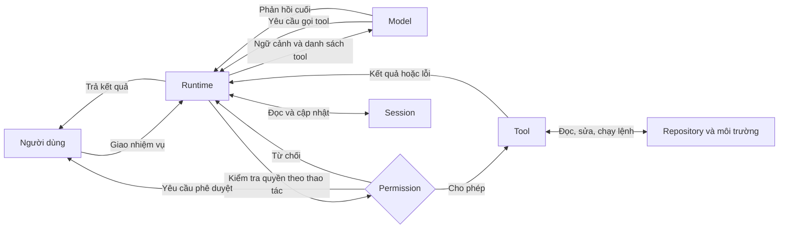
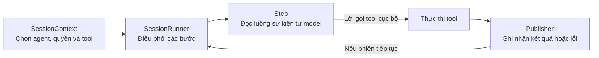

# Báo cáo tìm hiểu AI Coding Agent và OpenCode

Báo cáo trình bày cách AI coding agent xử lý một nhiệm vụ lập trình và phân tích OpenCode qua các thành phần chính như vòng lặp agent, công cụ, ngữ cảnh và quyền thực thi. Nội dung dựa trên tài liệu kỹ thuật và mã nguồn tại các commit được dẫn kèm. Phần cài đặt, so sánh phiên bản và thực nghiệm được trình bày trong [Báo cáo 2](REPORT_TASK2.md).

## 1. AI Coding Agent

### 1.1. Từ gợi ý code đến xử lý một nhiệm vụ

Xét yêu cầu “Sửa lỗi tính tổng giỏ hàng khi số lượng bằng 0”. Một hệ thống autocomplete có thể gợi ý biểu thức ở vị trí con trỏ. Với cùng bài toán ở cấp repository, coding agent có thể tìm hàm tính tổng, đọc test hiện có, chạy lệnh tái hiện lỗi, sửa file rồi kiểm tra lại. Nếu kết quả cho thấy nguyên nhân nằm ở cách chuẩn hóa dữ liệu đầu vào, agent có thể đổi hướng và đọc phần code đó.

Điểm đáng chú ý là **kết quả của bước trước ảnh hưởng đến hành động ở bước sau**. Trong một workflow cố định, chương trình định trước các bước và nhánh xử lý. Trong một agent, model có thể chọn bước tiếp theo dựa trên dữ liệu thu được trong lúc làm việc. Mức tự chủ thực tế còn phụ thuộc vào các tool khả dụng, quyền và điều kiện dừng do ứng dụng đặt ra. [Anthropic — Building Effective Agents](https://www.anthropic.com/engineering/building-effective-agents)

### 1.2. Kiến trúc và vòng lặp agent



*Hình 1. Sơ đồ minh họa luồng dữ liệu của một coding agent. Sau khi tool trả kết quả, runtime có thể gọi model thêm một lượt với ngữ cảnh đã cập nhật.* [Anthropic — Building Effective Agents](https://www.anthropic.com/engineering/building-effective-agents)

| Thành phần | Vai trò trong ví dụ giỏ hàng |
| --- | --- |
| **Model** | Đọc yêu cầu và dữ liệu đã có, rồi đề xuất đọc file, chạy test, sửa code hoặc trả lời. |
| **Runtime** | Chuẩn bị lời gọi model, chuyển yêu cầu đến tool tương ứng và đưa kết quả trở lại vòng lặp. Runtime cũng xử lý các điều kiện như lỗi, hủy tác vụ hoặc giới hạn bước. |
| **Tool** | Công bố mô tả và schema tham số. Mã triển khai của tool thực hiện thao tác thật, chẳng hạn tìm tên hàm hoặc chạy một lệnh test. |
| **Session và context** | Session lưu trạng thái và lịch sử. Context là phần dữ liệu được chuẩn bị cho một lần gọi model, gồm chỉ dẫn, yêu cầu, lịch sử và kết quả tool có liên quan. |
| **Permission** | Quyết định thao tác có thể chạy ngay, cần người dùng duyệt hay bị chặn. |

Một lượt xử lý giả định diễn ra như sau.

1. Model yêu cầu tìm hàm tính tổng. Tool trả về các vị trí khớp trong mã nguồn và test.
2. Agent đọc hai file liên quan và chạy test tái hiện lỗi. Kết quả thất bại cho thấy trường hợp số lượng bằng 0 đang trả giá trị sai.
3. Agent sửa phần xử lý liên quan rồi chạy lại test. Nếu phát hiện hồi quy, agent có thêm dữ liệu để xem lại bản sửa.
4. Khi dừng, agent có thể báo các file đã đổi, lệnh đã chạy và kết quả. Các dữ liệu đó cho người review cơ sở để đối chiếu với yêu cầu ban đầu.

### 1.3. Những điểm ảnh hưởng đến chất lượng

**Context quyết định model thấy gì.** Repository có thể lớn hơn giới hạn ngữ cảnh của model. Tool tìm kiếm giúp lấy đúng file và đoạn code theo nhu cầu. Với phiên dài, runtime có thể nén lịch sử để tiết kiệm chỗ. Việc nén cũng có thể làm mất chi tiết cần cho những bước sau, chẳng hạn một giả định đã bị bác bỏ. [Anthropic — Effective Context Engineering for AI Agents](https://www.anthropic.com/research/effective-context-engineering-for-ai-agents)

**Kết quả tool là dữ liệu để kiểm tra.** Một câu trả lời nói rằng lỗi đã được sửa có thể đối chiếu với diff và output test. Ngay cả khi test đã chạy thành công, mức độ tin cậy vẫn phụ thuộc vào hành vi được kiểm tra. Với ví dụ trên, cần xem test có thực sự bao phủ số lượng bằng 0 hay chỉ chạy những trường hợp thông thường. [Anthropic — Demystifying Evals for AI Agents](https://www.anthropic.com/research/demystifying-evals-for-ai-agents)

**Quyền thực thi đặt giới hạn cho mức tự chủ.** Model có thể đề xuất chạy một lệnh shell, còn runtime và môi trường thực thi quyết định lệnh có được chạy và có thể truy cập tài nguyên nào. Ví dụ, chặn một đường dẫn ở tool đọc file chỉ kiểm soát đường gọi đó. Khả năng đọc cùng đường dẫn qua shell còn phụ thuộc vào quy tắc shell và quyền của tiến trình. [Anthropic — Trustworthy Agents in Practice](https://www.anthropic.com/research/trustworthy-agents)

## 2. OpenCode

### 2.1. Agent, model và tool

OpenCode là một coding agent mã nguồn mở. Trong cấu hình OpenCode, từ *agent* còn có nghĩa cụ thể hơn là một hồ sơ kết hợp chỉ dẫn, lựa chọn model và quyền. **Build** hướng đến việc thực hiện thay đổi. **Plan** hướng đến việc khảo sát và lập kế hoạch, với quyền chỉnh sửa hạn chế hơn. OpenCode cũng phân biệt agent chính mà người dùng tương tác trực tiếp với subagent có thể nhận một nhiệm vụ được giao. [Repository OpenCode](https://github.com/anomalyco/opencode) · [Tài liệu Agents](https://opencode.ai/docs/agents/)

Các tool tích hợp cho agent cách đọc và tìm kiếm code, sửa file hoặc chạy lệnh. OpenCode có thể mở rộng tập thao tác thông qua custom tools và MCP. Với một yêu cầu như “đổi tên hàm và cập nhật các nơi gọi”, model có thể dùng tool tìm kiếm để xác định phạm vi, tool chỉnh sửa để thực hiện thay đổi và shell để chạy kiểm tra. Quyền thực thi quyết định những hành động nào có thể đi tiếp. [Tài liệu Tools](https://opencode.ai/docs/tools/) · [Tài liệu Permissions](https://opencode.ai/docs/permissions/)

### 2.2. Đọc mã nguồn theo luồng xử lý

Phần này lần theo quá trình chuẩn bị công cụ, thực thi lời gọi từ model và chuyển phiên sang bước tiếp theo. Các đoạn trích dưới đây lấy từ commit `12a661ea40cd5863b271a89bb06b8a3ddb7ab5a0` trên nhánh `dev`. Phân tích này dựa trên việc đọc code tại commit đó.



*Hình 2. Sơ đồ tổng hợp từ các đoạn mã bên dưới. Các mũi tên thể hiện vai trò trong luồng xử lý ở mức khái quát.* [Runner](https://github.com/anomalyco/opencode/blob/12a661ea40cd5863b271a89bb06b8a3ddb7ab5a0/packages/core/src/session/runner/llm.ts#L212-L230) · [Step](https://github.com/anomalyco/opencode/blob/12a661ea40cd5863b271a89bb06b8a3ddb7ab5a0/packages/core/src/session/runner/step.ts#L118-L143)

**Chuẩn bị ngữ cảnh.** Trong `SessionContext.select`, OpenCode chọn agent rồi hợp nhất quyền của agent và session. Kết quả được truyền vào `registry.snapshot` khi lấy tập tool cho ngữ cảnh. Phần còn lại của hàm cũng tải các nhóm chỉ dẫn, trong đó có skill và MCP. Bước này xác định tập tool cho ngữ cảnh. Việc xử lý từng thao tác diễn ra khi có lời gọi tool. [Mã nguồn context.ts, dòng 132–163](https://github.com/anomalyco/opencode/blob/12a661ea40cd5863b271a89bb06b8a3ddb7ab5a0/packages/core/src/session/context.ts#L132-L163)

```ts
const permissions = Permission.merge(agent.info.permissions, session.permissions ?? [])
```

**Điều phối vòng lặp.** Runner gọi `advanceToStep` trước mỗi bước. Kết quả khác `Ready` kết thúc vòng lặp hiện tại. Khi đã sẵn sàng, runner gọi `runStep` và tăng bộ đếm. Trong `runStep`, OpenCode còn tính kích thước ngữ cảnh, xử lý compaction và đặt `toolChoice` thành `"none"` khi đến giới hạn bước của agent. [Mã nguồn llm.ts, dòng 212–220](https://github.com/anomalyco/opencode/blob/12a661ea40cd5863b271a89bb06b8a3ddb7ab5a0/packages/core/src/session/runner/llm.ts#L212-L220) · [Chuẩn bị yêu cầu model, dòng 241–275](https://github.com/anomalyco/opencode/blob/12a661ea40cd5863b271a89bb06b8a3ddb7ab5a0/packages/core/src/session/runner/llm.ts#L241-L275)

```ts
const next = yield* advanceToStep()
if (next._tag !== "Ready") return next
continuing = yield* runStep(next.context, step)
```

**Thực thi và ghi nhận kết quả tool.** Trong mỗi bước, runtime đọc luồng sự kiện từ provider. Điều kiện dưới đây giới hạn nhánh thực thi cục bộ cho sự kiện gọi tool mà provider chưa thực thi. Sau đó code gọi `executeTool`, chuyển kết quả qua khâu giới hạn kích thước output rồi ghi nhận kết quả hoặc lỗi qua publisher. Như vậy, một yêu cầu gọi tool và kết quả của lần thực thi đó là hai thời điểm riêng trong vòng lặp. [Mã nguồn step.ts, dòng 118–140](https://github.com/anomalyco/opencode/blob/12a661ea40cd5863b271a89bb06b8a3ddb7ab5a0/packages/core/src/session/runner/step.ts#L118-L140)

```ts
if (event.type !== "tool-call" || event.providerExecuted) return
```

### 2.3. Quyền thực thi và phạm vi kiểm soát

OpenCode hỗ trợ ba quyết định quyền. `allow` cho phép chạy, `ask` yêu cầu người dùng duyệt và `deny` chặn thao tác. Quy tắc có thể áp dụng theo loại thao tác và tài nguyên, chẳng hạn đường dẫn cần sửa hoặc lệnh shell cần chạy. Trong V2, quy tắc khớp cuối cùng được áp dụng. Một cấu hình có thể đặt quy tắc chung yêu cầu duyệt lệnh shell, rồi thêm ngoại lệ cho phép xem diff và chặn push. V1 dùng các tên như `permission` và `bash`, còn V2 dùng `permissions` và `shell`. [Tài liệu quyền V1](https://opencode.ai/v1/docs/permissions/) · [Tài liệu quyền V2](https://opencode.ai/v2/docs/permissions/)

Việc theo dõi một lời gọi shell qua ba trường hợp `allow`, `ask` và `deny` giúp làm rõ cách cấu hình quyền ảnh hưởng đến hành vi thực thi. Các điểm cần đối chiếu gồm thời điểm runtime chờ phê duyệt, trạng thái được lưu khi thao tác bị từ chối và thông tin trả về cho model. Các ca thực nghiệm tương ứng được trình bày trong Báo cáo 2.
