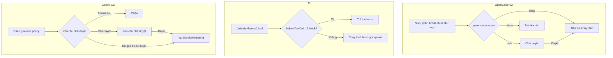
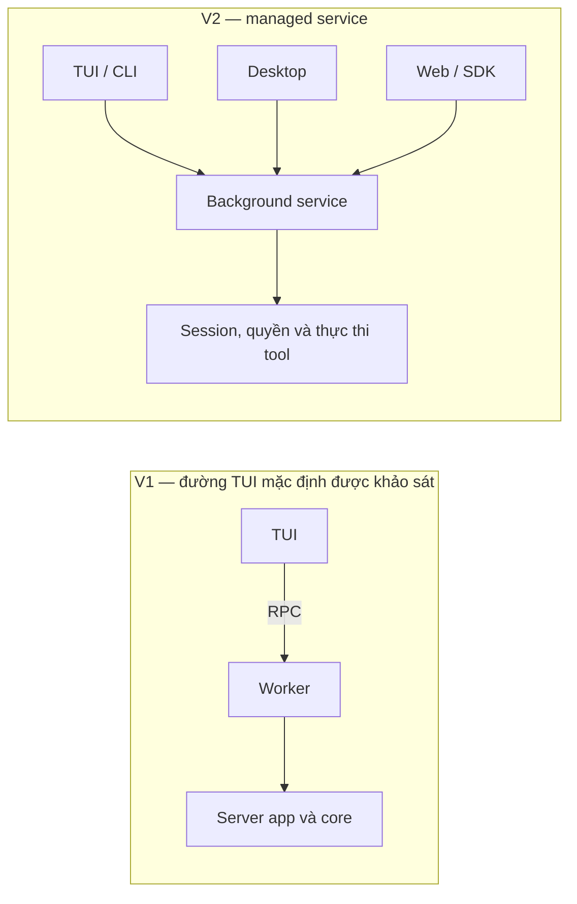
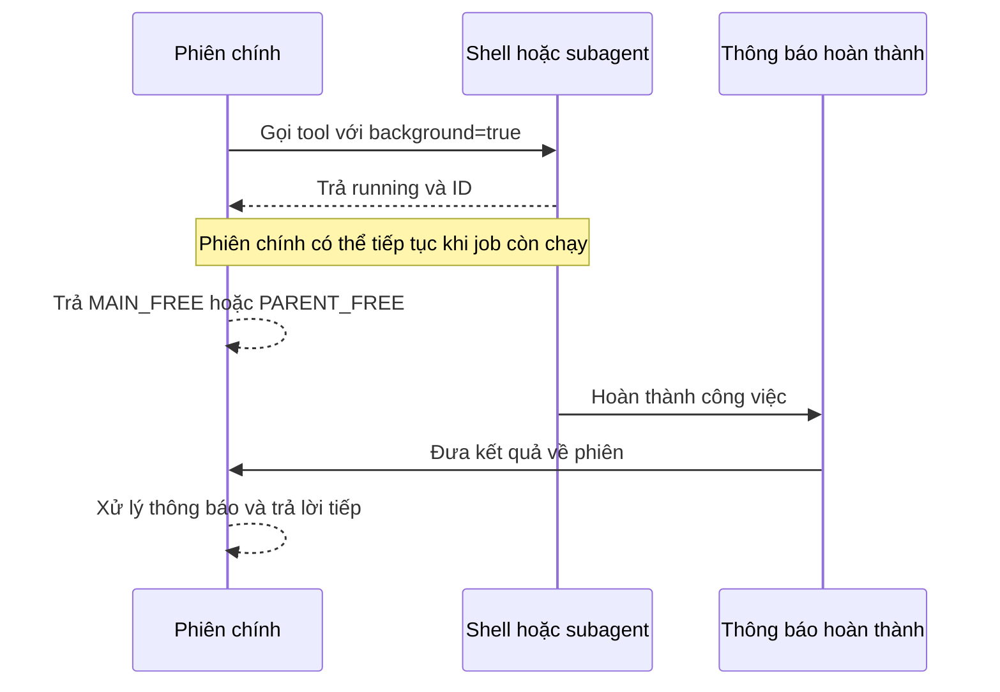
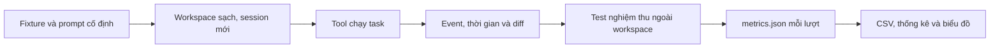
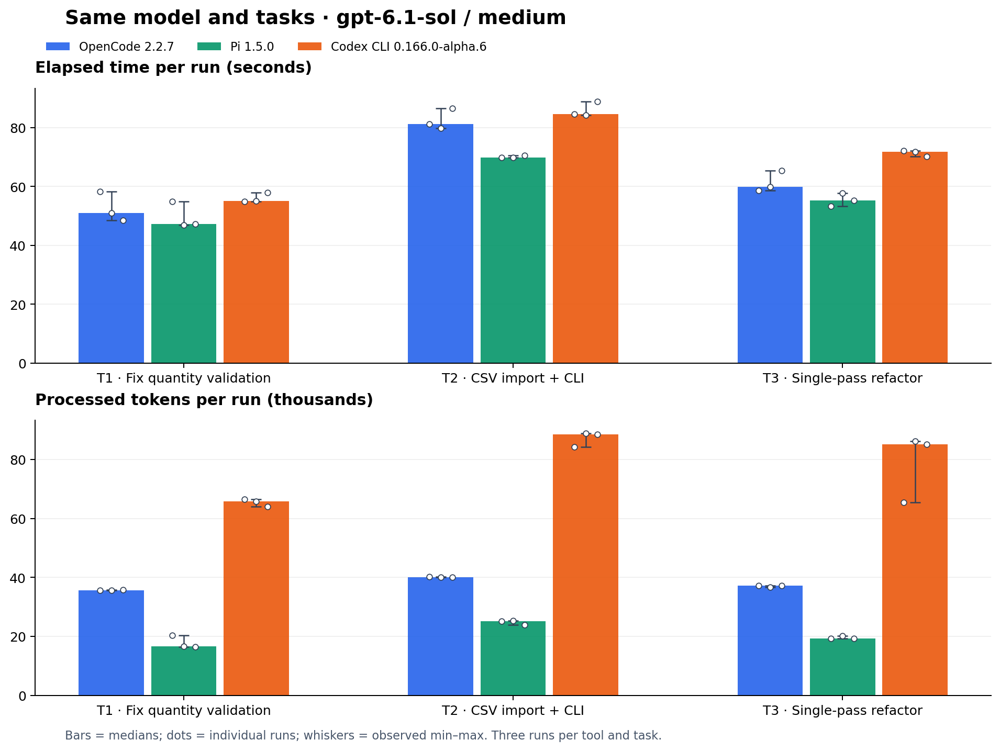
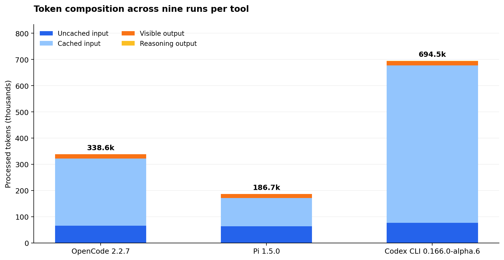

# Báo cáo 2 — So sánh OpenCode, Pi và Codex CLI

**Tên report:** So sánh OpenCode, Pi và Codex CLI

**Người thực hiện:** Nguyễn Văn Tài

Báo cáo đối chiếu OpenCode, Pi và Codex CLI qua mã nguồn, khảo sát OpenCode 1.x và 2.x bằng chạy thử, rồi đo ba công cụ trên cùng bộ task. Các phần thực nghiệm kèm script, dữ liệu, log và bản code kết quả để kiểm tra lại.

## 1. So sánh OpenCode, Pi và Codex CLI

Phạm vi phần này là **OpenCode V2**, **Pi Coding Agent** và **Codex CLI**, đọc theo ba snapshot dưới đây. Các kết luận mô tả đường thực thi trong source tại những commit này. OpenCode V1 được khảo sát riêng ở mục 2.

| Công cụ | Snapshot mã nguồn |
| --- | --- |
| OpenCode V2 | [`12a661e`](https://github.com/anomalyco/opencode/commit/12a661ea40cd5863b271a89bb06b8a3ddb7ab5a0) |
| Pi | [`ea1cfcc`](https://github.com/badlogic/pi-mono/commit/ea1cfcc4c8e82f3ed290abece64d9a76a8b6e2db) |
| Codex CLI | [`8703d32`](https://github.com/openai/codex/commit/8703d32bd0ea5cf26768859a3dd476df906ba053) |

### 1.1. Kiến trúc

- **OpenCode** có ranh giới HTTP–core rõ ở đường gửi prompt. Handler `session.prompt` lấy session ID và payload từ request, chuyển chúng vào dịch vụ `session.prompt` rồi ánh xạ lỗi miền sang lỗi HTTP. Trong core, `SessionContext.select` đọc session, kiểm tra location, chọn agent và lấy tập tool cùng chỉ dẫn. Runner dùng context đó để chuẩn bị từng bước. [HTTP handler](https://github.com/anomalyco/opencode/blob/12a661ea40cd5863b271a89bb06b8a3ddb7ab5a0/packages/server/src/handlers/session.ts#L289-L325) · [Chọn context](https://github.com/anomalyco/opencode/blob/12a661ea40cd5863b271a89bb06b8a3ddb7ab5a0/packages/core/src/session/context.ts#L126-L163) · [Chuẩn bị bước](https://github.com/anomalyco/opencode/blob/12a661ea40cd5863b271a89bb06b8a3ddb7ab5a0/packages/core/src/session/runner/llm.ts#L223-L246)
- **Pi** tổ chức ứng dụng quanh session runtime dùng chung. Entry point tạo session từ các dịch vụ, tạo runtime và chuyển runtime vào chế độ RPC hoặc print. Lõi vòng lặp nằm ở package `agent`, còn lớp `AgentSession` của coding-agent xử lý việc lưu message. Có thể lần theo hai lớp riêng khi đọc code: lớp chạy model và tool, và lớp quản lý phiên của ứng dụng. [Khởi tạo runtime](https://github.com/badlogic/pi-mono/blob/ea1cfcc4c8e82f3ed290abece64d9a76a8b6e2db/packages/coding-agent/src/main.ts#L898-L927) · [RPC và print](https://github.com/badlogic/pi-mono/blob/ea1cfcc4c8e82f3ed290abece64d9a76a8b6e2db/packages/coding-agent/src/main.ts#L1000-L1055) · [Agent loop](https://github.com/badlogic/pi-mono/blob/ea1cfcc4c8e82f3ed290abece64d9a76a8b6e2db/packages/agent/src/agent-loop.ts#L184-L214) · [Lưu message](https://github.com/badlogic/pi-mono/blob/ea1cfcc4c8e82f3ed290abece64d9a76a8b6e2db/packages/coding-agent/src/core/agent-session.ts#L1213-L1234)
- **Codex CLI** có entry point Rust chuyển nhánh `exec` sang `codex_exec::run_main` và có đường khởi chạy `codex_tui::run_main` cho TUI. Ở core, tác vụ regular gọi `run_turn` với session, turn context, input và cancellation token. Khi khảo sát hành vi của agent, `run_turn` là điểm đọc phù hợp hơn phần phân tích tham số của CLI. [CLI exec](https://github.com/openai/codex/blob/8703d32bd0ea5cf26768859a3dd476df906ba053/codex-rs/cli/src/main.rs#L1182-L1196) · [CLI TUI](https://github.com/openai/codex/blob/8703d32bd0ea5cf26768859a3dd476df906ba053/codex-rs/cli/src/main.rs#L2545-L2574) · [Regular task](https://github.com/openai/codex/blob/8703d32bd0ea5cf26768859a3dd476df906ba053/codex-rs/core/src/tasks/regular.rs#L143-L162) · [Turn](https://github.com/openai/codex/blob/8703d32bd0ea5cf26768859a3dd476df906ba053/codex-rs/core/src/session/turn.rs#L217-L239)

### 1.2. Vòng lặp agent

Cùng xét tình huống model yêu cầu đọc file rồi cần thêm một lượt để trả lời.

| Công cụ | Cách vòng lặp xử lý tình huống |
| --- | --- |
| OpenCode | `advanceToStep` chuẩn bị bước kế tiếp. Khi trả về `Ready`, runner chạy `runStep`. Bên trong bước, stream từ model phát sự kiện `tool-call`; nếu provider chưa thực thi, core chạy tool, giới hạn output và chuyển kết quả hoặc lỗi cho publisher. Runner dùng `needsContinuation` của bước để điều phối tiếp. [Vòng lặp](https://github.com/anomalyco/opencode/blob/12a661ea40cd5863b271a89bb06b8a3ddb7ab5a0/packages/core/src/session/runner/llm.ts#L212-L220) · [Xử lý stream](https://github.com/anomalyco/opencode/blob/12a661ea40cd5863b271a89bb06b8a3ddb7ab5a0/packages/core/src/session/runner/step.ts#L118-L143) · [Quyết định tiếp tục](https://github.com/anomalyco/opencode/blob/12a661ea40cd5863b271a89bb06b8a3ddb7ab5a0/packages/core/src/session/runner/llm.ts#L313-L326) |
| Pi | Lõi agent thực thi batch tool call, đưa từng tool result vào `currentContext.messages` và tiếp tục nếu batch chưa yêu cầu kết thúc. Sau mỗi lượt, `finishTurn` và các hàng đợi steering, follow-up có thể thay đổi bước tiếp theo. Nếu model dừng vì giới hạn độ dài, Pi tạo lỗi cho các tool call trong message đó thay vì thực thi batch có thể chứa tham số bị cắt. [Xử lý batch và điều kiện dừng](https://github.com/badlogic/pi-mono/blob/ea1cfcc4c8e82f3ed290abece64d9a76a8b6e2db/packages/agent/src/agent-loop.ts#L272-L330) |
| Codex CLI | Khi một response item được nhận diện là tool call, core tạo future thực thi và bật `needs_follow_up`. Sau sampling, `run_turn` kết hợp cờ này với việc còn input đang chờ. Khi cả hai đều hết, code chuyển sang xử lý stop hook và kết thúc turn theo kết quả của nhánh đó. [Tạo tool future](https://github.com/openai/codex/blob/8703d32bd0ea5cf26768859a3dd476df906ba053/codex-rs/core/src/stream_events_utils.rs#L379-L406) · [Quyết định follow-up](https://github.com/openai/codex/blob/8703d32bd0ea5cf26768859a3dd476df906ba053/codex-rs/core/src/session/turn.rs#L660-L691) · [Nhánh stop](https://github.com/openai/codex/blob/8703d32bd0ea5cf26768859a3dd476df906ba053/codex-rs/core/src/session/turn.rs#L805-L832) |

Điểm khác biệt trong cách biểu diễn trạng thái thể hiện ngay ở ba đường đọc trên. OpenCode truyền trạng thái tiếp tục giữa các step. Pi thêm tool result trực tiếp vào message array của vòng lặp. Codex gộp nhu cầu follow-up do model với input đang chờ trong turn. [OpenCode](https://github.com/anomalyco/opencode/blob/12a661ea40cd5863b271a89bb06b8a3ddb7ab5a0/packages/core/src/session/runner/llm.ts#L212-L220) · [Pi](https://github.com/badlogic/pi-mono/blob/ea1cfcc4c8e82f3ed290abece64d9a76a8b6e2db/packages/agent/src/agent-loop.ts#L279-L308) · [Codex](https://github.com/openai/codex/blob/8703d32bd0ea5cf26768859a3dd476df906ba053/codex-rs/core/src/session/turn.rs#L663-L691)

```mermaid
flowchart TB
    subgraph O["OpenCode V2"]
        O1["advanceToStep → Ready"] --> O2["runStep → stream từ model"]
        O2 --> O3["Chạy tool cục bộ và ghi kết quả"]
        O3 --> O4{"needsContinuation?"}
        O4 -->|Có| O1
        O4 -->|Không| O5["Xét điều kiện kết thúc bước"]
    end
    subgraph P["Pi"]
        P1["Gọi model với currentContext"] --> P2["Chạy batch tool"]
        P2 --> P3["Thêm tool result vào messages"]
        P3 --> P4{"Còn lượt tiếp theo?"}
        P4 -->|Có| P1
        P4 -->|Không| P5["Phát agent_end"]
    end
    subgraph C["Codex CLI"]
        C1["Sampling trong run_turn"] --> C2["Tạo future thực thi tool"]
        C2 --> C3["Đặt cờ needs_follow_up"]
        C3 --> C4{"Cần follow-up hoặc còn input?"}
        C4 -->|Có| C1
        C4 -->|Không| C5["Xử lý stop hook"]
    end
```



*Hình 1. Ba đường xử lý khi model gọi tool. Sơ đồ rút gọn các nhánh lỗi và hủy. Điều kiện tiếp tục ở Pi còn xét steering, follow-up và quyết định từ `finishTurn`.* [OpenCode](https://github.com/anomalyco/opencode/blob/12a661ea40cd5863b271a89bb06b8a3ddb7ab5a0/packages/core/src/session/runner/llm.ts#L212-L220) · [Pi](https://github.com/badlogic/pi-mono/blob/ea1cfcc4c8e82f3ed290abece64d9a76a8b6e2db/packages/agent/src/agent-loop.ts#L272-L330) · [Codex CLI](https://github.com/openai/codex/blob/8703d32bd0ea5cf26768859a3dd476df906ba053/codex-rs/core/src/session/turn.rs#L660-L691)

### 1.3. Hệ thống tool

| Công cụ | Từ định nghĩa đến thực thi |
| --- | --- |
| OpenCode | Dịch vụ tool chuyển schema khi đăng ký và cung cấp snapshot cho session. Tool `read` là ví dụ về việc khai báo thao tác và triển khai `execute` cùng kiểm tra quyền ngay tại tool. Bước chạy model chuyển tool call cục bộ đến executor rồi giới hạn kích thước đầu ra. [Đăng ký tool](https://github.com/anomalyco/opencode/blob/12a661ea40cd5863b271a89bb06b8a3ddb7ab5a0/packages/core/src/tool.ts#L398-L426) · [Snapshot của session](https://github.com/anomalyco/opencode/blob/12a661ea40cd5863b271a89bb06b8a3ddb7ab5a0/packages/core/src/session/context.ts#L132-L146) · [Read tool](https://github.com/anomalyco/opencode/blob/12a661ea40cd5863b271a89bb06b8a3ddb7ab5a0/packages/core/src/tool/plugin/read.ts#L38-L82) · [Thực thi](https://github.com/anomalyco/opencode/blob/12a661ea40cd5863b271a89bb06b8a3ddb7ab5a0/packages/core/src/session/runner/step.ts#L125-L140) |
| Pi | `AgentSession` gộp built-in tool với tool từ extension, sau đó chọn tool hoạt động. Ví dụ `bash` khai báo tham số bằng TypeBox. Lõi agent tìm tool theo tên, chuẩn bị và validate tham số trước khi chạy hook. Việc chạy một batch tuần tự hay song song có nhánh riêng trong agent loop. [Registry và active tools](https://github.com/badlogic/pi-mono/blob/ea1cfcc4c8e82f3ed290abece64d9a76a8b6e2db/packages/coding-agent/src/core/agent-session.ts#L3701-L3742) · [Bash schema](https://github.com/badlogic/pi-mono/blob/ea1cfcc4c8e82f3ed290abece64d9a76a8b6e2db/packages/coding-agent/src/core/tools/bash.ts#L39-L54) · [Validate](https://github.com/badlogic/pi-mono/blob/ea1cfcc4c8e82f3ed290abece64d9a76a8b6e2db/packages/agent/src/agent-loop.ts#L725-L755) · [Chọn cách chạy batch](https://github.com/badlogic/pi-mono/blob/ea1cfcc4c8e82f3ed290abece64d9a76a8b6e2db/packages/agent/src/agent-loop.ts#L518-L533) |
| Codex CLI | `ToolRouter` giữ registry và cung cấp danh sách spec model nhìn thấy. Router chuyển response item thành tool call, rồi dispatch qua registry. Cách tách này cho phép theo dõi riêng spec gửi cho model và đường xử lý khi model thực sự gọi tool. [Spec model nhìn thấy](https://github.com/openai/codex/blob/8703d32bd0ea5cf26768859a3dd476df906ba053/codex-rs/core/src/tools/router.rs#L123-L170) · [Dựng tool call](https://github.com/openai/codex/blob/8703d32bd0ea5cf26768859a3dd476df906ba053/codex-rs/core/src/tools/router.rs#L278-L350) · [Dispatch](https://github.com/openai/codex/blob/8703d32bd0ea5cf26768859a3dd476df906ba053/codex-rs/core/src/tools/router.rs#L374-L436) |

### 1.4. Permission, phê duyệt và sandbox

Ba câu hỏi được xét riêng ở đây là model có thấy tool không, lần gọi cụ thể có cần duyệt không, và tiến trình chạy lệnh chịu giới hạn nào.

- **OpenCode** hợp nhất quyền agent và session khi dựng snapshot tool. Khi shell thực thi, nó phân tích lệnh và đường dẫn, kiểm tra truy cập thư mục ngoài phạm vi và gọi `permission.assert` với các tài nguyên lệnh đã phân tích. Hàm `evaluate` tìm rule khớp cuối cùng. Nhánh `assert` trả lỗi khi `deny`, đi tiếp khi `allow`, hoặc tạo yêu cầu rồi chờ quyết định khi `ask`. [Snapshot](https://github.com/anomalyco/opencode/blob/12a661ea40cd5863b271a89bb06b8a3ddb7ab5a0/packages/core/src/session/context.ts#L132-L146) · [Shell authorization](https://github.com/anomalyco/opencode/blob/12a661ea40cd5863b271a89bb06b8a3ddb7ab5a0/packages/core/src/tool/plugin/shell.ts#L117-L142) · [So khớp rule](https://github.com/anomalyco/opencode/blob/12a661ea40cd5863b271a89bb06b8a3ddb7ab5a0/packages/core/src/permission.ts#L94-L108) · [Xử lý quyết định](https://github.com/anomalyco/opencode/blob/12a661ea40cd5863b271a89bb06b8a3ddb7ab5a0/packages/core/src/permission.ts#L257-L287)
- **Pi** kiểm soát tool khả dụng qua registry và tập active tool. Trên đường thực thi model gọi tool, `beforeToolCall` có thể trả `block`; lõi chuyển quyết định thành tool error. Lớp extension chuyển sự kiện `tool_call` tới handler và trả ngay khi một handler chặn. Ở triển khai bash mặc định được khảo sát, Pi gọi `spawn` với shell, cwd và môi trường. Hook chặn trước khi chạy và quyền của tiến trình con là hai điểm kiểm soát riêng. [Active tools](https://github.com/badlogic/pi-mono/blob/ea1cfcc4c8e82f3ed290abece64d9a76a8b6e2db/packages/coding-agent/src/core/agent-session.ts#L3715-L3742) · [Chuyển sự kiện từ session](https://github.com/badlogic/pi-mono/blob/ea1cfcc4c8e82f3ed290abece64d9a76a8b6e2db/packages/coding-agent/src/core/agent-session.ts#L721-L741) · [Hook chặn](https://github.com/badlogic/pi-mono/blob/ea1cfcc4c8e82f3ed290abece64d9a76a8b6e2db/packages/coding-agent/src/core/extensions/runner.ts#L1255-L1274) · [Trả tool error](https://github.com/badlogic/pi-mono/blob/ea1cfcc4c8e82f3ed290abece64d9a76a8b6e2db/packages/agent/src/agent-loop.ts#L737-L765) · [Spawn shell](https://github.com/badlogic/pi-mono/blob/ea1cfcc4c8e82f3ed290abece64d9a76a8b6e2db/packages/coding-agent/src/core/tools/bash.ts#L116-L142)
- **Codex CLI** đánh giá policy lệnh thành yêu cầu phê duyệt, chẳng hạn `Forbidden` hoặc `Skip`; quyết định `Prompt` được xử lý cùng cấu hình approval. Tool orchestrator kiểm tra yêu cầu này, gọi bước phê duyệt khi cần và xây dựng `SandboxAttempt` cho lần thực thi. Khi đọc một trường hợp lệnh bị chặn, cần xác định nó dừng ở policy, phê duyệt hay sandbox. [Ánh xạ quyết định policy](https://github.com/openai/codex/blob/8703d32bd0ea5cf26768859a3dd476df906ba053/codex-rs/core/src/exec_policy.rs#L415-L510) · [Xử lý approval](https://github.com/openai/codex/blob/8703d32bd0ea5cf26768859a3dd476df906ba053/codex-rs/core/src/tools/orchestrator.rs#L157-L235) · [Tạo sandbox attempt](https://github.com/openai/codex/blob/8703d32bd0ea5cf26768859a3dd476df906ba053/codex-rs/core/src/tools/orchestrator.rs#L356-L400)



*Hình 2. Các điểm kiểm soát trên đường chạy một lệnh shell. Mỗi cột mô tả luồng riêng của một công cụ. Các nhánh từ chối sau khi hỏi được lược bớt.* [OpenCode shell](https://github.com/anomalyco/opencode/blob/12a661ea40cd5863b271a89bb06b8a3ddb7ab5a0/packages/core/src/tool/plugin/shell.ts#L117-L142) · [Pi tool hook](https://github.com/badlogic/pi-mono/blob/ea1cfcc4c8e82f3ed290abece64d9a76a8b6e2db/packages/agent/src/agent-loop.ts#L737-L765) · [Codex approval](https://github.com/openai/codex/blob/8703d32bd0ea5cf26768859a3dd476df906ba053/codex-rs/core/src/tools/orchestrator.rs#L157-L235)

### 1.5. Quản lý context

| Công cụ | Context gửi model và compaction |
| --- | --- |
| OpenCode | Mỗi step ước lượng kích thước prompt, gọi compaction và chuẩn bị transcript từ chỉ dẫn, tool và message đã load. Nếu compaction hoàn tất, runner quay lại chuẩn bị bước. Khi chạm giới hạn bước của agent, nó thêm chỉ dẫn kết thúc và đặt `toolChoice` thành `none`. [Chuẩn bị model request](https://github.com/anomalyco/opencode/blob/12a661ea40cd5863b271a89bb06b8a3ddb7ab5a0/packages/core/src/session/runner/llm.ts#L241-L275) |
| Pi | Lõi agent cho phép `transformContext` xử lý message trước khi `convertToLlm` chuyển sang dạng gửi provider. Ở lớp session, Pi kiểm tra ngưỡng token và có đường xử lý compaction do threshold hoặc overflow. Khi lưu kết quả nén, session ghi cả summary và ID entry đầu tiên cần giữ, rồi làm mới projection. [Chuyển đổi context](https://github.com/badlogic/pi-mono/blob/ea1cfcc4c8e82f3ed290abece64d9a76a8b6e2db/packages/agent/src/agent-loop.ts#L392-L412) · [Ngưỡng](https://github.com/badlogic/pi-mono/blob/ea1cfcc4c8e82f3ed290abece64d9a76a8b6e2db/packages/coding-agent/src/core/agent-session.ts#L3230-L3254) · [Lưu compaction](https://github.com/badlogic/pi-mono/blob/ea1cfcc4c8e82f3ed290abece64d9a76a8b6e2db/packages/coding-agent/src/core/agent-session.ts#L3325-L3347) |
| Codex CLI | `run_turn` có nhánh kiểm tra compaction trước sampling. Sau sampling, core thu trạng thái token và input đang chờ. Nếu chọn rollover giữa turn, core gọi `run_auto_compact` và có thể tiếp tục turn sau khi nén. Đây là điểm cần xem khi phân tích vì sao cùng một tác vụ dài có thêm lượt gọi model. [Pre-sampling](https://github.com/openai/codex/blob/8703d32bd0ea5cf26768859a3dd476df906ba053/codex-rs/core/src/session/turn.rs#L242-L281) · [Trạng thái sau sampling](https://github.com/openai/codex/blob/8703d32bd0ea5cf26768859a3dd476df906ba053/codex-rs/core/src/session/turn.rs#L677-L691) · [Mid-turn compaction](https://github.com/openai/codex/blob/8703d32bd0ea5cf26768859a3dd476df906ba053/codex-rs/core/src/session/turn.rs#L740-L786) |

### 1.6. Khả năng mở rộng

- **OpenCode** plugin host cung cấp bề mặt `tool.transform`, `tool.reload`, `tool.list` và hook tool. Host cũng có bề mặt thao tác với cấu hình MCP. Hai điểm mở rộng có vai trò khác nhau: plugin có thể tác động vào registry và lifecycle, còn MCP đưa tích hợp bên ngoài vào hệ thống. [Tool host](https://github.com/anomalyco/opencode/blob/12a661ea40cd5863b271a89bb06b8a3ddb7ab5a0/packages/core/src/plugin/host.ts#L502-L507) · [MCP host](https://github.com/anomalyco/opencode/blob/12a661ea40cd5863b271a89bb06b8a3ddb7ab5a0/packages/core/src/plugin/host.ts#L425-L442)
- **Pi** extension gọi `registerTool` để đăng ký tool và có thể lắng nghe `tool_call`. `AgentSession` hợp nhất các tool đã đăng ký với built-in tool. Đây là đường thêm hành vi qua extension mà không cần sửa lõi `agent-loop`. [Đăng ký tool](https://github.com/badlogic/pi-mono/blob/ea1cfcc4c8e82f3ed290abece64d9a76a8b6e2db/packages/coding-agent/src/core/extensions/loader.ts#L298-L320) · [Ghép registry](https://github.com/badlogic/pi-mono/blob/ea1cfcc4c8e82f3ed290abece64d9a76a8b6e2db/packages/coding-agent/src/core/agent-session.ts#L3701-L3717) · [Tool-call hook](https://github.com/badlogic/pi-mono/blob/ea1cfcc4c8e82f3ed290abece64d9a76a8b6e2db/packages/coding-agent/src/core/extensions/runner.ts#L1255-L1274)
- **Codex CLI** có hai điểm mở rộng liên quan trực tiếp đến đường tool đã khảo sát. Khâu lập tool plan thêm MCP tool vào registry. Khâu thực thi chạy hook trước và sau tool theo hợp đồng riêng. MCP cung cấp thao tác để model gọi, còn hook can thiệp vào vòng đời của lời gọi. [Ghép MCP tool vào plan](https://github.com/openai/codex/blob/8703d32bd0ea5cf26768859a3dd476df906ba053/codex-rs/core/src/tools/spec_plan.rs#L137-L176) · [PreToolUse](https://github.com/openai/codex/blob/8703d32bd0ea5cf26768859a3dd476df906ba053/codex-rs/core/src/tools/registry.rs#L1080-L1138) · [PostToolUse](https://github.com/openai/codex/blob/8703d32bd0ea5cf26768859a3dd476df906ba053/codex-rs/core/src/tools/registry.rs#L948-L994)

## 2. Thực nghiệm OpenCode 1.19.5 và 2.2.7

Phần này khảo sát năm thay đổi qua mã nguồn đúng phiên bản và các lượt chạy trên Linux x64 ngày **11/11/2026**. Hai bản được cài thành hai binary độc lập, chạy server đồng thời trên hai cổng loopback và dùng chung model miễn phí **`opencode/minimax-m3.1-flash-free`**. Script, cấu hình, plugin và log nằm trong [thư mục thực nghiệm](experiments/opencode-v1-v2/).

### 2.1. Chọn phiên bản và dựng môi trường

Metadata npm của `opencode-ai` và `@opencode/cli` được lọc theo major, loại prerelease rồi lấy phiên bản semver lớn nhất. Kết quả ở thời điểm tải là `1.19.5` và `2.2.7`. Việc chọn theo major cần thiết vì hai nhánh dùng package phát hành khác nhau. Mốc “cuối” và “mới nhất” trong báo cáo được hiểu tại thời điểm thực nghiệm. Bản ghi cài đặt lưu phiên bản, commit, package nền tảng và SHA-256 của archive lẫn binary. [Manifest cài đặt](experiments/opencode-v1-v2/evidence/install-manifest.json)

| Thành phần | OpenCode V1 | OpenCode V2 |
| --- | --- | --- |
| Phiên bản | `1.19.5` | `2.2.7` |
| Package CLI | `opencode-ai` | `@opencode/cli` |
| Package binary Linux x64 | `opencode-linux-x64@1.19.5` | `@opencode/cli-linux-x64@2.2.7` |
| Commit của tag | `810c0eba1a7348036f8bdf61e6632d0c36c6876c` | `fedc6f208aa2bd54c1019227214568083f6380ad` |
| Binary trong lab | `/tmp/opencode-lab/v1/package/bin/opencode` | `/tmp/opencode-lab/v2/package/bin/opencode` |
| Server thử API | `127.0.0.1:14195` | `127.0.0.1:14227` |
| Repo thử | `/tmp/opencode-lab/project-v1` | `/tmp/opencode-lab/project-v2` |
| Thư mục dữ liệu và cấu hình | `/tmp/opencode-lab/home-v1` | `/tmp/opencode-lab/home-v2` |

Git đã có sẵn. Binary Linux được tải trực tiếp từ npm và giải nén vào thư mục lab. Bun `1.4.4` được dùng để cài dependency và chạy TypeScript SDK. Model được lấy từ catalog mà server V2 trả về và được gọi thành công trên cả hai bản. Không cần nhập API key cá nhân cho các lượt chạy này. [Catalog model thu được](experiments/opencode-v1-v2/evidence/model-catalog-v2.json) · [Kết quả V1](experiments/opencode-v1-v2/evidence/runtime-v1-results.json) · [Kết quả V2](experiments/opencode-v1-v2/evidence/runtime-v2-results.json)

Các biến `XDG_CONFIG_HOME`, `XDG_DATA_HOME`, `XDG_CACHE_HOME`, `XDG_STATE_HOME` và `OPENCODE_TEST_HOME` tách đường dẫn cho từng tiến trình. `OPENCODE_TEST_HOME` có điểm hỗ trợ trong source của cả hai bản. Các binary được gọi bằng đường dẫn đầy đủ. Nhờ đó, chạy V1 và V2 không phụ thuộc vào bản nào đang đứng trước trong `PATH`. [Global path V1](https://github.com/anomalyco/opencode/blob/810c0eba1a7348036f8bdf61e6632d0c36c6876c/packages/core/src/global.ts#L9-L28) · [Global path V2](https://github.com/anomalyco/opencode/blob/fedc6f208aa2bd54c1019227214568083f6380ad/packages/util/src/global.ts#L8-L27) · [Mã thiết lập môi trường lab](experiments/opencode-v1-v2/scripts/lab_env.py)

Trong lần khởi tạo đầu, V1 có lỗi HTTP 500 và log cũ ghi nhận lỗi tải catalog/certificate. Sau khi dùng dependency đã cài cục bộ, tách home và khởi động lại server, các ca V1 chạy thành công. Chưa tách riêng được một nguyên nhân duy nhất cho lỗi khởi tạo đó. Kết quả ở các mục sau lấy từ lượt chạy thành công, còn log server được giữ để kiểm tra quá trình xử lý lỗi. Dependency môi trường plugin V1 được tái sử dụng bằng symlink và lock metadata từ các package đã cài trong lab. [Setup tái lập](experiments/opencode-v1-v2/scripts/setup.py) · [Log server V1](experiments/opencode-v1-v2/evidence/server-v1.log) · [Log bootstrap V1](experiments/opencode-v1-v2/evidence/bootstrap-v1.log)

### 2.2. Kiến trúc và background service chung

Ở V1, đường chạy TUI mặc định tạo một `Worker` rồi dùng RPC để giao tiếp với worker đó. Worker cung cấp thao tác `fetch` bằng cách chuyển request đến ứng dụng server trong tiến trình, đồng thời có thể mở HTTP listener khi được yêu cầu. Vì vậy, V1 đã có server API và cơ chế client–server. Đặc điểm cần đối chiếu khi chuyển V2 là cách tổ chức và khám phá service dùng chung. [TUI tạo worker V1](https://github.com/anomalyco/opencode/blob/810c0eba1a7348036f8bdf61e6632d0c36c6876c/packages/opencode/src/cli/cmd/tui.ts#L247-L266) · [Worker xử lý request và listener](https://github.com/anomalyco/opencode/blob/810c0eba1a7348036f8bdf61e6632d0c36c6876c/packages/opencode/src/cli/tui/worker.ts#L28-L57)

Ở V2, resolver của CLI chọn giữa endpoint chỉ định qua `--server`, server riêng qua `--standalone`, và managed service. Với đường managed mặc định, nó gọi `Service.ensure`. Hàm này kiểm tra registration, phiên bản và sức khỏe service, rồi tái sử dụng hoặc khởi chạy service theo kết quả. Desktop cũng gọi `Service.ensure` và dùng lệnh CLI `serve --service` khi cần tạo tiến trình server. [CLI chọn kết nối](https://github.com/anomalyco/opencode/blob/fedc6f208aa2bd54c1019227214568083f6380ad/packages/cli/src/services/server-connection.ts#L27-L65) · [Cơ chế ensure](https://github.com/anomalyco/opencode/blob/fedc6f208aa2bd54c1019227214568083f6380ad/packages/client/src/promise/service.ts#L19-L98) · [Desktop kết nối service](https://github.com/anomalyco/opencode/blob/fedc6f208aa2bd54c1019227214568083f6380ad/packages/desktop/src/main/service/background-service.ts#L57-L85)



*Hình 3. Sơ đồ tổng hợp từ các đường kết nối trong source. SDK thử nghiệm kết nối vào endpoint của managed service; đường kết nối Desktop được xác minh bằng mã nguồn.* [V1 worker](https://github.com/anomalyco/opencode/blob/810c0eba1a7348036f8bdf61e6632d0c36c6876c/packages/opencode/src/cli/tui/worker.ts#L28-L57) · [V2 CLI](https://github.com/anomalyco/opencode/blob/fedc6f208aa2bd54c1019227214568083f6380ad/packages/cli/src/services/server-connection.ts#L27-L65) · [V2 Desktop](https://github.com/anomalyco/opencode/blob/fedc6f208aa2bd54c1019227214568083f6380ad/packages/desktop/src/main/service/background-service.ts#L57-L85)

Bài thử managed service dùng XDG riêng dưới `/tmp/opencode-lab/managed` và cổng `14333`. Script gọi `Service.ensure` lần thứ nhất, tạo session bằng client A, gọi `ensure` lần thứ hai rồi đọc lại session bằng client B. Hai lần đọc `server.info` trả cùng PID. Session ID của A và B cũng trùng nhau. HTTP GET trang web trả `200` và `Content-Type: text/html`. Script dừng service sau khi thu dữ liệu. [Script service](experiments/opencode-v1-v2/scripts/shared-service.ts) · [Bằng chứng service](experiments/opencode-v1-v2/evidence/shared-service.json)

TUI thật cũng được mở qua pseudo-terminal với endpoint và session ID của service này. Bản ghi terminal có tiền tố tiêu đề `Shared lab sessio` do tab giới hạn chiều rộng, không có lỗi kết nối và tiến trình thoát với mã 0 sau khi nhận thao tác đóng. Desktop chưa được khởi chạy trong lab; nhận định về Desktop dựa trên đường `Service.ensure` trong source. [Bản ghi terminal](experiments/opencode-v1-v2/evidence/tui-render.txt) · [Kết quả TUI và service](experiments/opencode-v1-v2/evidence/shared-service.json)

Việc dùng một service chung cũng có nghĩa là phiên và tác vụ thuộc về server mà client kết nối tới. Khi cần tái lập thử nghiệm độc lập, có thể chọn `--standalone` hoặc endpoint riêng. Trong lab này, ca so sánh tool dùng hai HTTP server riêng, còn ca kiến trúc dùng managed service để kiểm tra đúng cơ chế tái sử dụng tiến trình. [Nhánh standalone và managed](https://github.com/anomalyco/opencode/blob/fedc6f208aa2bd54c1019227214568083f6380ad/packages/cli/src/services/server-connection.ts#L27-L65) · [Driver hai server](experiments/opencode-v1-v2/scripts/with_servers.py)

### 2.3. API/SDK mới và script đã chạy

Hai bản dùng các hợp đồng request khác nhau trên đường gửi prompt. V1 có các endpoint tạo session và gửi message dưới `/session`; SDK tương ứng là `@opencode-ai/sdk`. V2 dùng `@opencode/client`, có endpoint `/api/session` và `/api/session/:sessionID/prompt`. Đọc đúng package và endpoint giúp tránh nhầm SDK khi chuyển phiên bản. [Endpoint V1](https://github.com/anomalyco/opencode/blob/810c0eba1a7348036f8bdf61e6632d0c36c6876c/packages/opencode/src/server/routes/instance/httpapi/groups/session.ts#L78-L103) · [Package SDK V1](https://github.com/anomalyco/opencode/blob/810c0eba1a7348036f8bdf61e6632d0c36c6876c/packages/sdk/js/package.json#L1-L30) · [Client tạo session V2](https://github.com/anomalyco/opencode/blob/fedc6f208aa2bd54c1019227214568083f6380ad/packages/client/src/promise/generated/client.ts#L625-L645) · [Client gửi prompt V2](https://github.com/anomalyco/opencode/blob/fedc6f208aa2bd54c1019227214568083f6380ad/packages/client/src/promise/generated/client.ts#L744-L765)

| Thao tác | V1 | V2 |
| --- | --- | --- |
| Tạo client | `createOpencodeClient(...)` | `OpenCode.make(...)` |
| Tạo session | SDK nhận options theo `body`, `query` | `session.create({ location, model, ... })` |
| Gửi prompt trong lab | `POST /session/:id/message` với `parts` | `session.prompt({ sessionID, text })` |
| Nhận event trong lab | SSE `/event`, dữ liệu trong `properties` | `event.subscribe()`, dữ liệu trong `data` |
| Theo dõi hoàn thành | Đọc response message và lịch sử phiên | Theo dõi event kết thúc execution của đúng session |

Các ô trong bảng được đối chiếu từ request/response và event đã thu trong lab. Ở V2, `session.prompt` trả về một mục inbox đã tiếp nhận. Bài thử tiếp tục chờ event kết thúc execution để lấy phản hồi của model. Điều này quan trọng với script tự động hóa vì nhận được xác nhận gửi prompt chưa chứng minh model đã trả lời xong. [Request schema V2](https://github.com/anomalyco/opencode/blob/fedc6f208aa2bd54c1019227214568083f6380ad/packages/client/src/promise/generated/types.ts#L3389-L3419) · [Bản ghi API V2](experiments/opencode-v1-v2/evidence/api-v2-summary.json) · [Event V1](experiments/opencode-v1-v2/evidence/v1-plugin.jsonl)

Script dùng Promise SDK V2, mở subscription trước khi gửi prompt và chờ `server.connected` để tránh bỏ lỡ những event đầu tiên. Sau đó tạo session, chọn model, gửi prompt, lọc event theo `data.sessionID` và lưu log JSONL. Source server cho thấy subscription dùng SSE, có frame `server.connected` và heartbeat. [SSE handler](https://github.com/anomalyco/opencode/blob/fedc6f208aa2bd54c1019227214568083f6380ad/packages/server/src/handlers/event.ts#L8-L33) · [SDK event subscription](https://github.com/anomalyco/opencode/blob/fedc6f208aa2bd54c1019227214568083f6380ad/packages/client/test/promise.test.ts#L780-L817)

```ts
import { OpenCode } from '@opencode/client';
import { appendFileSync } from 'node:fs';
const output = new URL('../evidence/api-v2-events.jsonl', import.meta.url);
await Bun.write(output, '');
const client = OpenCode.make({
  baseUrl: process.env.LAB_SERVER ?? 'http://127.0.0.1:14227',
  headers: { Authorization: 'Basic ' + btoa('opencode:lab-local-only') },
});
const controller = new AbortController();
const timer = setTimeout(() => controller.abort(new Error('Lab timeout after 120 seconds')), 120_000);
let sessionID: string | undefined;
let connected!: () => void;
const ready = new Promise<void>(resolve => { connected = resolve; });
const events: unknown[] = [];
const listening = (async () => {
  for await (const event of client.event.subscribe({ signal: controller.signal })) {
    if (event.type === 'server.connected') connected();
    if (!sessionID || (event as any).data?.sessionID !== sessionID) continue;
    events.push(event);
    appendFileSync(output, JSON.stringify(event) + '\n');
    if (['session.execution.succeeded', 'session.execution.failed', 'session.execution.interrupted'].includes(event.type)) return event;
  }
})();
try {
  await Promise.race([ready,listening.then(()=>{throw new Error("Event stream closed before ready");})]);
  const session = await client.session.create({
    title: 'Migration lab API smoke',
    location: { directory: '/tmp/opencode-lab/project-v2' },
    model: { providerID: 'opencode', id: process.env.LAB_MODEL ?? 'minimax-m3.1-flash-free' },
  });
  sessionID = session.id;
  const start = performance.now();
  const admitted = await client.session.prompt({ sessionID, text: 'Reply exactly MIGRATION_API_OK. Do not use tools.' });
  const terminal = await listening;
  if (!terminal) throw new Error("Event stream ended without an execution result");
  const context = await client.session.context({ sessionID });
  const summary = { version: '2.2.7', sessionID, admitted, terminal, elapsedMs: Math.round(performance.now()-start), context, eventCount: events.length };
  await Bun.write(new URL('../evidence/api-v2-summary.json', import.meta.url), JSON.stringify(summary, null, 2));
  console.log(JSON.stringify({sessionID,eventCount:events.length,terminal,elapsedMs:summary.elapsedMs}));
} finally {
  clearTimeout(timer);
  controller.abort();
  await listening.catch(() => undefined);
}
```

*Đoạn mã trên là script đã dùng trong lab. Toàn bộ file và dữ liệu đầu ra được lưu cùng báo cáo.* [sdk-smoke.ts](experiments/opencode-v1-v2/scripts/sdk-smoke.ts) · [Event JSONL](experiments/opencode-v1-v2/evidence/api-v2-events.jsonl)

Kết quả lượt smoke test nhận được `MIGRATION_API_OK`, gồm **13 event của session** và kết thúc bằng `session.execution.succeeded`. Thời gian từ lúc gửi prompt đến khi nhận kết quả là **2.637 ms**. Usage ghi `input=3647`, `output=7`, `reasoning=0`, `cache.read=1792`, `cache.write=0`, cost báo về bằng 0. Các trường được giữ theo cách provider trả về. [Kết quả và context](experiments/opencode-v1-v2/evidence/api-v2-summary.json)

### 2.4. Permission — thay đổi dạng cấu hình và độ ưu tiên

V1 cho phép gom quy tắc theo tool trong object. Hàm `fromConfig` chuyển object thành danh sách rule bằng thứ tự `Object.entries`. Khi đánh giá, V1 cũng dùng `findLast`. V2 biểu diễn native bằng mảng rule có ba trường `action`, `resource`, `effect`, và hàm `evaluate` tiếp tục tìm rule khớp cuối cùng. Vì vậy, chuyển V2 làm thứ tự rule hiển thị trực tiếp trong cấu hình; thứ tự cũng đã có ý nghĩa trong triển khai V1 được chọn. [Chuyển config V1](https://github.com/anomalyco/opencode/blob/810c0eba1a7348036f8bdf61e6632d0c36c6876c/packages/opencode/src/permission/index.ts#L186-L201) · [Evaluate V1](https://github.com/anomalyco/opencode/blob/810c0eba1a7348036f8bdf61e6632d0c36c6876c/packages/opencode/src/permission/index.ts#L28-L39) · [Evaluate V2](https://github.com/anomalyco/opencode/blob/fedc6f208aa2bd54c1019227214568083f6380ad/packages/core/src/permission.ts#L94-L108)

Cấu hình V1 của bài thử dùng tên tool `bash`.

```json
{
  "permission": {
    "bash": {
      "*": "allow",
      "printf LAB_ASK": "ask",
      "printf LAB_DENY": "deny"
    }
  }
}
```

Cấu hình V2 tương ứng dùng action `shell`.

```json
{
  "permissions": [
    { "action": "shell", "resource": "*", "effect": "allow" },
    { "action": "shell", "resource": "printf LAB_ASK", "effect": "ask" },
    { "action": "shell", "resource": "printf LAB_DENY", "effect": "deny" }
  ]
}
```

Các cấu hình đầy đủ còn chứa model và đường dẫn plugin. V2 có bước normalize nhận cả cấu hình quyền cũ và mới, rồi ghép rule của `tools`, `permission` và `permissions` theo thứ tự. Do đó, khả năng chấp nhận cấu hình cũ và khả năng chạy plugin cũ cần được kiểm tra riêng. [Config V1](experiments/opencode-v1-v2/configs/v1.json) · [Config V2](experiments/opencode-v1-v2/configs/v2.json) · [Normalize V2](https://github.com/anomalyco/opencode/blob/fedc6f208aa2bd54c1019227214568083f6380ad/packages/core/src/config/normalize.ts#L179-L190)

| Ca chạy | V1 1.19.5 | V2 2.2.7 | Căn cứ nghiệm thu |
| --- | --- | --- | --- |
| `printf LAB_ALLOW` | Chạy, trả `LAB_ALLOW` | Chạy, trả `LAB_ALLOW` | Tool hoàn thành và output khớp |
| `printf LAB_ASK` | Có một yêu cầu duyệt | Có một yêu cầu duyệt | Có `permission.asked`, script trả `once`, sau đó tool hoàn thành |
| `printf LAB_DENY` | Tool trả lỗi rule cấm | Tool trả `permission.rejected` | Không có tool success của lệnh bị cấm |

Script tự động duyệt **đúng lệnh `printf LAB_ASK` một lần** để thực nghiệm chạy xuyên suốt. Các yêu cầu khác được từ chối. Ở ca `deny`, execution của V2 vẫn có thể kết thúc thành công sau khi model thông báo lệnh bị chặn. Vì vậy, trạng thái thành công của execution cần được đọc cùng kết quả tool để xác định lệnh có thực thi hay không. [Trace ask V1](experiments/opencode-v1-v2/evidence/v1-ask.jsonl) · [Trace ask V2](experiments/opencode-v1-v2/evidence/v2-ask.jsonl) · [Trace deny V2](experiments/opencode-v1-v2/evidence/v2-deny.jsonl)

Bài thử thứ tự V2 dùng cùng lệnh `printf LAB_ORDER` trong hai session. Khi rule rộng `shell/*/ask` đứng trước và rule cụ thể `allow` đứng sau, không phát sinh yêu cầu duyệt. Khi đảo vị trí, có một `permission.asked`. Hai lượt xác nhận bằng runtime rằng rule khớp cuối cùng quyết định kết quả trong trường hợp này. [Script đảo rule](experiments/opencode-v1-v2/scripts/rule-order.ts) · [Log hai thứ tự](experiments/opencode-v1-v2/evidence/rule-order.json)

### 2.5. Subagent và shell chạy nền

V1 `1.19.5` đã triển khai subagent nền, nhưng kiểm tra cờ `OPENCODE_EXPERIMENTAL_BACKGROUND_SUBAGENTS`. Khi cờ tắt, schema gửi model chỉ chứa các tham số cơ bản và phần mô tả không bổ sung hướng dẫn chạy nền. Khi bật, `background=true` có thể đi vào nhánh chạy nền. [Điều kiện experimental](https://github.com/anomalyco/opencode/blob/810c0eba1a7348036f8bdf61e6632d0c36c6876c/packages/opencode/src/tool/task.ts#L93-L103) · [Schema theo cờ](https://github.com/anomalyco/opencode/blob/810c0eba1a7348036f8bdf61e6632d0c36c6876c/packages/opencode/src/tool/task.ts#L361-L368) · [Nhánh trả nền](https://github.com/anomalyco/opencode/blob/810c0eba1a7348036f8bdf61e6632d0c36c6876c/packages/opencode/src/tool/task.ts#L284-L318)

Trong lượt V1 mặc định, model gọi `task` mà không truyền `background`; tool đợi child hoàn thành rồi mới trả về. Lượt riêng có bật cờ đã gọi `task` với `background=true`, trả `<task ... state="running">` trong **13 ms**, sau đó phiên chính trả `PARENT_FREE`. Lịch sử phiên có thông báo child hoàn thành cùng marker `CHILD_DONE`. Hai lượt này phân biệt được hành vi mặc định với khả năng experimental đã tồn tại ở V1. [V1 mặc định](experiments/opencode-v1-v2/evidence/runtime-v1-results.json) · [V1 bật experimental](experiments/opencode-v1-v2/evidence/runtime-v1-background-enabled.json)

V2 đưa tham số `background` vào input schema của cả `subagent` và `shell` tại các điểm đọc được khảo sát. Subagent có nhánh khởi chạy công việc nền và trả session ID. Shell có nhánh chuyển job sang nền và trả shell ID cùng file output. Shell nền mặc định không đặt timeout nếu người gọi không cung cấp timeout riêng. [Subagent input và mô tả](https://github.com/anomalyco/opencode/blob/fedc6f208aa2bd54c1019227214568083f6380ad/packages/core/src/tool/plugin/subagent.ts#L28-L62) · [Subagent thực thi](https://github.com/anomalyco/opencode/blob/fedc6f208aa2bd54c1019227214568083f6380ad/packages/core/src/tool/plugin/subagent.ts#L200-L243) · [Shell input](https://github.com/anomalyco/opencode/blob/fedc6f208aa2bd54c1019227214568083f6380ad/packages/core/src/tool/plugin/shell.ts#L47-L59) · [Shell timeout](https://github.com/anomalyco/opencode/blob/fedc6f208aa2bd54c1019227214568083f6380ad/packages/core/src/tool/plugin/shell.ts#L186-L194) · [Shell trả nền](https://github.com/anomalyco/opencode/blob/fedc6f208aa2bd54c1019227214568083f6380ad/packages/core/src/tool/plugin/shell.ts#L234-L247)

| Ca V2 | Thao tác | Tool trả sau | Phiên chính kết thúc lượt đầu sau | Kết thúc lượt xử lý thông báo sau |
| --- | --- | --- | --- | --- |
| Shell nền | `sleep 5; printf LAB_BACKGROUND_DONE` với `background=true` | 9 ms | 1.379 ms | 8.877 ms |
| Subagent nền | `general`, `background=true`; child chạy `sleep 5; printf CHILD_DONE` | 7 ms | 1.757 ms | 10.404 ms |

Các mốc V2 tính từ `session.tool.called`. “Kết thúc lượt xử lý thông báo” bao gồm thời gian agent nhận thông báo và gọi model để phản hồi. Nó có thể muộn hơn thời điểm tiến trình con thực sự thoát. Ở shell nền, phiên chính đã trả `MAIN_FREE` trước khi lệnh `sleep 5` có thể hoàn tất. Ở subagent nền, nó trả `PARENT_FREE` trước khi child báo kết quả. [Mốc thời gian trích từ log](experiments/opencode-v1-v2/evidence/background-timing.json) · [Trace shell](experiments/opencode-v1-v2/evidence/v2-background-shell.jsonl) · [Trace subagent](experiments/opencode-v1-v2/evidence/v2-background-subagent.jsonl)



*Hình 4. Luồng được quan sát trong các trace V2. Subagent V1 khi bật experimental cũng trả trạng thái chạy rồi gửi thông báo hoàn thành về sau.* [Bằng chứng V2](experiments/opencode-v1-v2/evidence/background-timing.json) · [Bằng chứng V1](experiments/opencode-v1-v2/evidence/runtime-v1-background-enabled.json)

Schema shell V1 ở bản đã chọn khai báo `command`, `timeout`, `workdir`; không có tham số native `background` như tool shell V2. Đây là khác biệt trên giao diện tool được khảo sát. Báo cáo chưa thử các cách quản lý tiến trình khác của V1 để kết luận toàn bộ khả năng chạy nền của hệ điều hành hay các API experimental liên quan. [Schema shell V1](https://github.com/anomalyco/opencode/blob/810c0eba1a7348036f8bdf61e6632d0c36c6876c/packages/opencode/src/tool/shell/prompt.ts#L15-L25) · [Schema shell V2](https://github.com/anomalyco/opencode/blob/fedc6f208aa2bd54c1019227214568083f6380ad/packages/core/src/tool/plugin/shell.ts#L47-L59)

### 2.6. Port plugin V1 sang V2

Plugin thử nghiệm thêm tool `lab_echo`. Với input `PORT_OK`, tiêu chí nghiệm thu là tool thực sự chạy và trả **`MIGRATION_PLUGIN:PORT_OK`**. Chuỗi marker cho phép kiểm tra từ tool output trong log, thay vì chỉ dựa vào lời model mô tả.

Plugin V1 export một hàm khởi tạo, trả object chứa hook và định nghĩa tool. Helper `tool` nhận `args` theo Zod cùng hàm `execute`; kết quả có thể là chuỗi. [Kiểu plugin V1](https://github.com/anomalyco/opencode/blob/810c0eba1a7348036f8bdf61e6632d0c36c6876c/packages/plugin/src/index.ts#L56-L79) · [Helper tool V1](https://github.com/anomalyco/opencode/blob/810c0eba1a7348036f8bdf61e6632d0c36c6876c/packages/plugin/src/tool.ts#L36-L54)

```ts
import { tool } from '@opencode-ai/plugin';

export default async () => ({
  tool: {
    lab_echo: tool({
      description: 'Return the migration lab marker followed by the supplied text.',
      args: { text: tool.schema.string() },
      async execute({ text }) {
        return `MIGRATION_PLUGIN:${text}`;
      },
    }),
  },
});
```

Plugin V2 dùng default export là một định nghĩa có `id` cùng `setup` hoặc `effect`. Với Promise API, `setup` đăng ký tool qua `ctx.tool.transform`. Tool mới khai báo schema input/output bằng Effect Schema và trả giá trị output cùng content đưa về model. Loader V2 kiểm tra hình dạng module trước khi khởi tạo plugin. [Định nghĩa Promise plugin](https://github.com/anomalyco/opencode/blob/fedc6f208aa2bd54c1019227214568083f6380ad/packages/plugin/src/promise/plugin.ts#L62-L71) · [Ví dụ tool trong SDK plugin](https://github.com/anomalyco/opencode/blob/fedc6f208aa2bd54c1019227214568083f6380ad/packages/plugin/src/README.md#L149-L164) · [Schema module](https://github.com/anomalyco/opencode/blob/fedc6f208aa2bd54c1019227214568083f6380ad/packages/core/src/plugin/module.ts#L81-L94)

```ts
import { Plugin } from '@opencode/plugin';
import { Schema } from 'effect';

export default Plugin.define({
  id: 'lab.echo',
  async setup(ctx) {
    await ctx.tool.transform(editor => {
      editor.add({
        name: 'lab_echo',
        description: 'Return the migration lab marker followed by the supplied text.',
        options: { codemode: false },
        input: Schema.Struct({ text: Schema.String }),
        output: Schema.Struct({ text: Schema.String }),
        async execute({ text }) {
          const result = `MIGRATION_PLUGIN:${text}`;
          return { output: { text: result }, content: result };
        },
      });
    });
  },
});
```

Các thay đổi khi port gồm package import, default export, vị trí đăng ký tool, schema tham số và cấu trúc kết quả. `options.codemode=false` được đặt để tool thử nghiệm xuất hiện trực tiếp trong danh sách model gọi. Plugin V2 được cấu hình bằng đường dẫn thư mục chứa `index.ts`. [Plugin V1 hoàn chỉnh](experiments/opencode-v1-v2/plugins/v1/index.ts) · [Plugin V2 hoàn chỉnh](experiments/opencode-v1-v2/plugins/v2/index.ts) · [Cách resolve entrypoint local](https://github.com/anomalyco/opencode/blob/fedc6f208aa2bd54c1019227214568083f6380ad/packages/plugin/src/host.ts#L25-L64)

| Trường hợp | Kết quả thực tế |
| --- | --- |
| Plugin V1 trên OpenCode 1.19.5 | `lab_echo` hoàn thành và trả `MIGRATION_PLUGIN:PORT_OK` |
| Plugin đã port trên OpenCode 2.2.7 | Plugin `lab.echo` ở trạng thái `active`; tool trả cùng marker |
| Plugin V1 nguyên bản trên OpenCode 2.2.7 | Catalog plugin ghi `failed`; loader báo thiếu định nghĩa đúng hợp đồng |

Ca không tương thích giữ nguyên code V1, đặt trong một thư mục local hợp lệ cho V2, reload location rồi khởi tạo session để buộc runtime nạp plugin. Lỗi thu được là `Plugin must export a default definition with an id and an effect or setup function.` Source loader tạo đúng lỗi này khi module không khớp schema. Sau ca thử, script khôi phục cấu hình về plugin đã port. [Script đối chứng](experiments/opencode-v1-v2/scripts/compatibility.ts) · [Catalog, event và context thu được](experiments/opencode-v1-v2/evidence/plugin-compatibility.json) · [Điểm phát lỗi trong loader](https://github.com/anomalyco/opencode/blob/fedc6f208aa2bd54c1019227214568083f6380ad/packages/core/src/plugin/module.ts#L168-L185)

### 2.7. Tổng hợp bằng chứng và giới hạn thực nghiệm

| Hạng mục | Kết quả được xác nhận |
| --- | --- |
| Cài song song | Hai binary đúng phiên bản, hai repo thử, hai server riêng, có manifest và checksum |
| Background service | Hai lần ensure tái sử dụng PID; hai client đọc cùng session; web trả HTML |
| API/SDK V2 | Tạo session, gửi prompt, nhận SSE và phản hồi model thật |
| Permission | Cả hai bản chạy đủ allow/ask/deny; V2 được thử thêm hai thứ tự rule chồng lấn |
| Subagent nền | V1 chạy khi bật experimental flag; V2 chạy bằng tham số `background=true` |
| Shell nền | V2 trả ngay trạng thái running và thông báo hoàn thành về sau |
| Plugin | V1 gốc chạy trên V1, bản port chạy trên V2, V1 gốc bị loader V2 từ chối |

Mỗi ca chức năng chạy một lần thành công sau khi môi trường được thiết lập. Các khoảng thời gian trong mục này chỉ mô tả lượt chạy, chưa đủ để xếp hạng tốc độ hoặc độ ổn định giữa hai phiên bản. Tác vụ chỉ dùng marker và lệnh shell ngắn để tập trung kiểm tra cơ chế. Thử nghiệm hủy tác vụ, recovery sau restart, mất kết nối SSE và tải đồng thời chưa được thực hiện trong phần này. Desktop được đối chiếu từ source; phạm vi runtime được ghi cùng bằng chứng service và TUI. [Quan sát tổng hợp từ dữ liệu gốc](experiments/opencode-v1-v2/evidence/observations.json) · [Bằng chứng service](experiments/opencode-v1-v2/evidence/shared-service.json)

### 2.8. Tái lập các lượt chạy

Chạy từ thư mục `experiments/opencode-v1-v2`. Script setup tải đúng binary Linux x64 đã ghim, kiểm tra checksum, cài dependency theo Bun lockfile và tạo lại cấu hình theo vị trí repo hiện tại.

```bash
python3 scripts/setup.py

# V2: tạo session, gửi prompt và nhận event
python3 scripts/with_servers.py /tmp/opencode-lab/runtime/bun-linux-x64/bun scripts/sdk-smoke.ts

# V2: plugin, allow/ask/deny, shell nền và subagent nền
python3 scripts/with_servers.py /tmp/opencode-lab/runtime/bun-linux-x64/bun scripts/runtime-v2.ts

# V1: plugin, allow/ask/deny và hành vi task mặc định
python3 scripts/with_servers.py /tmp/opencode-lab/runtime/bun-linux-x64/bun scripts/runtime-v1.ts

# V2: đảo thứ tự rule
python3 scripts/with_servers.py /tmp/opencode-lab/runtime/bun-linux-x64/bun scripts/rule-order.ts

# Plugin V1 trên V2, sau đó V1 subagent có bật cờ experimental
LAB_V1_BACKGROUND=1 python3 scripts/with_servers.py /tmp/opencode-lab/runtime/bun-linux-x64/bun scripts/final-probes.ts

# Managed service, hai client, trang web và TUI
/tmp/opencode-lab/runtime/bun-linux-x64/bun scripts/shared-service.ts

# Tổng hợp quan sát từ log JSON
python3 scripts/summarize.py
python3 scripts/verify_results.py
```

Các script ghi lại kết quả vào `evidence/`, nên một lượt tái lập sẽ cập nhật các file tương ứng. Model miễn phí trong bài thử phụ thuộc catalog provider tại thời điểm chạy. Nếu model bị gỡ, cần chọn model khả dụng khác và ghi lại thay đổi đó. Các bản cài trong `/tmp/opencode-lab` có thể bị hệ điều hành dọn; script setup dựng lại được binary và môi trường theo manifest. [Setup](experiments/opencode-v1-v2/scripts/setup.py) · [Bun lockfile](experiments/opencode-v1-v2/bun.lock)

## 3. Thực nghiệm cùng bộ task trên OpenCode, Pi và Codex CLI

Thực nghiệm dùng một repository Python nhỏ, ba yêu cầu cố định và test nghiệm thu tách khỏi workspace của agent. Mỗi công cụ chạy mỗi task ba lần trên bản sao sạch. Tổng số lượt theo thiết kế là **27**, cùng model **`gpt-6.1-sol`** và reasoning **`medium`**. Mỗi lượt được chấm ngay sau khi công cụ dừng, giữ lại log, diff và bản code kết quả để đối chiếu. [Dataset và hash đầu vào](experiments/tool-benchmark/dataset.json) · [Mã điều phối](experiments/tool-benchmark/scripts/run_benchmark.py)

### 3.1. Bộ dữ liệu và yêu cầu của từng task

Repository mẫu là **Cartkit**, gồm tính tổng tiền đơn hàng bằng số nguyên cents, báo cáo đơn hàng theo trạng thái và CLI đọc dữ liệu JSON. Dự án dùng Python standard library, có bốn test gốc và dữ liệu đơn hàng mẫu. Cách chọn này giúp lượt chạy tập trung vào đọc code, chỉnh sửa và kiểm tra hành vi. [Repository đầu vào](experiments/tool-benchmark/fixture/) · [Dữ liệu mẫu](experiments/tool-benchmark/fixture/sample_orders.json) · [Bốn test gốc](experiments/tool-benchmark/fixture/tests/test_existing.py)

| Task | Công việc giao cho agent | Test nghiệm thu | Điểm của code gốc |
| --- | --- | --- | --- |
| T1 — sửa lỗi | Sửa cách xử lý quantity bằng 0, giữ mặc định 1 khi thiếu trường và từ chối kiểu dữ liệu không hợp lệ | 9 | 3/9 |
| T2 — thêm tính năng | Thêm parser CSV, gom dòng theo order ID và nối lệnh `import-csv` vào CLI hiện có | 12 | 0/12 |
| T3 — refactor | Gom logic thống kê vào helper dùng chung và hỗ trợ iterable chỉ duyệt được một lần | 8 | 6/8 |

Tổng cộng có **29 test nghiệm thu** cho ba task. Code gốc vẫn vượt qua cả bốn test sẵn có, trong khi các test bổ sung phát hiện những hành vi cần sửa hoặc chưa được triển khai. T2 đạt 0 vì module và lệnh CSV chưa tồn tại. [Kết quả baseline](experiments/tool-benchmark/dataset.json) · [Log test gốc](experiments/tool-benchmark/results/baseline-tests.log)

**T1 — sửa lỗi tính tiền.** Biểu thức ban đầu là `line.get('quantity') or 1`. Nó thay giá trị 0 bằng 1, đồng thời che mất các giá trị sai như `None` hoặc `False` trước bước kiểm tra kiểu. Task yêu cầu phân biệt trường bị thiếu với trường có giá trị cụ thể. Test kiểm tra giỏ hàng chỉ có quantity 0, giỏ hỗn hợp, mặc định khi thiếu trường, kiểu không hợp lệ, làm tròn discount half-up, phí vận chuyển và việc giữ nguyên input. [Code gốc](experiments/tool-benchmark/fixture/cartkit/money.py) · [Prompt T1](experiments/tool-benchmark/prompts/T1.txt) · [Test T1](experiments/tool-benchmark/acceptance/T1.py)

**T2 — parser CSV và CLI.** Input phải có đúng bốn cột `order_id`, `sku`, `quantity`, `unit_price_cents`; thứ tự header có thể thay đổi. Parser cần trim khoảng trắng, xử lý quoting chuẩn CSV, giữ thứ tự đơn hàng xuất hiện lần đầu và giữ thứ tự các dòng trong từng đơn. Các ca lỗi gồm header thừa/thiếu/trùng, sai số ô, ID rỗng, số âm, số thập phân, chuỗi boolean và chữ số Unicode. Test CLI gọi tiến trình Python rồi parse JSON trả về để kiểm tra tính năng qua entry point người dùng. [Prompt T2](experiments/tool-benchmark/prompts/T2.txt) · [Test T2](experiments/tool-benchmark/acceptance/T2.py)

Ví dụ input hợp lệ của T2 và output mong đợi được thể hiện dưới đây.

```csv
order_id,sku,quantity,unit_price_cents
A,X,1,10
B,Y,2,20
A,X,3,30
```

```json
[
  {"order_id":"A","lines":[
    {"sku":"X","quantity":1,"unit_price_cents":10},
    {"sku":"X","quantity":3,"unit_price_cents":30}
  ]},
  {"order_id":"B","lines":[
    {"sku":"Y","quantity":2,"unit_price_cents":20}
  ]}
]
```

**T3 — refactor có ràng buộc hành vi.** Code gốc duyệt input nhiều lần và lặp lại logic cộng tiền theo khách hàng. Ngoài generator thông thường, test dùng một iterable ném lỗi khi `__iter__` bị gọi lần thứ hai. Các trường hợp khác kiểm tra paid order có tổng 0, đơn pending/cancelled, thứ tự customer key và việc giữ nguyên dữ liệu đầu vào. Cách dùng helper được xem thêm trong bản code kết quả. [Code gốc](experiments/tool-benchmark/fixture/cartkit/reports.py) · [Prompt T3](experiments/tool-benchmark/prompts/T3.txt) · [Test T3](experiments/tool-benchmark/acceptance/T3.py)

### 3.2. Cấu hình và quy trình chạy

| Thành phần | Cấu hình dùng trong lượt đo |
| --- | --- |
| OpenCode | `2.2.7`, chạy một server lab riêng và điều khiển qua Promise SDK |
| Pi | `1.5.0`, CLI JSON mode, chạy bằng Bun `1.4.4` |
| Codex CLI | `0.166.0-alpha.6`, binary có sẵn trên máy, `exec --json --ephemeral` |
| Model | `gpt-6.1-sol` cho cả ba tool |
| Reasoning | `medium` |
| Ngôn ngữ và dependency của task | Python 3.12, standard library |
| Giới hạn thời gian | 240 giây cho mỗi lượt agent |
| Số lần lặp | 3 lượt cho mỗi tổ hợp tool–task |
| Thực thi | Tuần tự, xoay thứ tự tool theo task và lần lặp |
| Workspace | Bản sao sạch dưới `/tmp/coding-benchmark/workspaces/<run_id>` |

Cả ba tool đã vượt qua smoke test bằng model được chọn trước khi bắt đầu task. Ban đầu đã thử dùng model miễn phí của OpenCode qua endpoint trực tiếp; endpoint đó trả HTTP 429. Bộ số liệu chính dùng đăng nhập OpenAI hiện có của từng công cụ. Pi nhập credential từ đăng nhập Codex vào thư mục riêng. OpenCode nhập đúng credential OpenAI đang hoạt động vào DB lab qua API. Credential nằm trong `/tmp`, còn thư mục kết quả chứa dữ liệu đo và mã nguồn tái lập. [Chuẩn bị auth riêng](experiments/tool-benchmark/scripts/prepare_auth.py) · [Server lab](experiments/tool-benchmark/scripts/server.py) · [Smoke Codex](experiments/tool-benchmark/results/smoke-native-codex.jsonl) · [Smoke Pi](experiments/tool-benchmark/results/smoke-native-pi.jsonl) · [Smoke OpenCode](experiments/tool-benchmark/results/smoke-native-opencode.jsonl)

Mỗi lượt nhận cùng prompt task, cùng phần nhắc đọc README và cùng nội dung repo. Pi dùng `--no-extensions --no-skills --no-session`. Codex dùng thư mục cấu hình benchmark riêng, `workspace-write` và chế độ không hỏi phê duyệt. OpenCode cho phép các thao tác của task trong cấu hình lab. Các system prompt và định nghĩa tool gốc vẫn thuộc về từng harness. Đây là những khác biệt của sản phẩm cần quan sát trong thực nghiệm. [Câu lệnh và cấu hình trong runner](experiments/tool-benchmark/scripts/run_benchmark.py) · [Adapter OpenCode](experiments/tool-benchmark/scripts/run-opencode.ts)

Một lượt chạy có trình tự sau.

1. Sao chép fixture và tạo commit baseline với timestamp cố định.
2. Mở session mới, gửi đúng prompt và bắt đầu đồng hồ đo.
3. Thu stdout/event JSONL và stderr đến khi công cụ dừng hoặc timeout.
4. Chạy test nghiệm thu từ bên ngoài workspace, rồi chạy lại toàn bộ thư mục test của repo.
5. Kiểm tra file test gốc vẫn giữ nguyên, lưu diff và snapshot bản sửa.
6. Tính token từ event gốc và ghi `metrics.json` cho lượt đó.

Một lần chạy được đánh dấu hoàn thành khi công cụ kết thúc thành công, toàn bộ test nghiệm thu và test repo đạt, file test gốc giữ nguyên và không bị timeout. Vì vậy, lời agent nói đã sửa xong được kiểm tra tiếp bằng dữ liệu thực thi. [Grader](experiments/tool-benchmark/scripts/grade.py) · [Điều kiện terminal và nghiệm thu](experiments/tool-benchmark/scripts/run_benchmark.py)



*Hình 5. Quy trình của benchmark. Test nghiệm thu là code do harness thực thi sau khi agent kết thúc.* [Runner](experiments/tool-benchmark/scripts/run_benchmark.py) · [Phân tích số liệu](experiments/tool-benchmark/scripts/analyze.py)

### 3.3. Cách đo token và thời gian

**Thời gian** là wall-clock từ lúc tạo tiến trình chạy task đến khi tiến trình đó kết thúc. Nó bao gồm đọc repository, gọi model, thực thi tool, các test do agent tự chạy và ghi đầu ra. Việc chuẩn bị workspace và chạy grader sau đó nằm ngoài đồng hồ. OpenCode dùng server đã khởi động, còn Pi và Codex đi qua CLI mới ở mỗi lượt. Vì thế, số đo phản ánh các entry point được chọn trong lab. [Hàm launch](experiments/tool-benchmark/scripts/run_benchmark.py)

**Token** được chuẩn hóa trước khi so sánh. OpenCode ghi `input` không cache và tách output nhìn thấy khỏi reasoning. Pi cũng tách input không cache, nhưng `output` của nó đã bao gồm reasoning. Codex trả tổng input và cached input theo trường riêng trong `turn.completed`; reasoning là một phần của output. Cộng cached input vào `input_tokens` của Codex hoặc cộng reasoning thêm vào output của Pi sẽ làm số liệu bị tính hai lần. [OpenCode usage](https://github.com/anomalyco/opencode/blob/fedc6f208aa2bd54c1019227214568083f6380ad/packages/core/src/session/usage.ts#L11-L20) · [Pi usage](https://github.com/badlogic/pi-mono/blob/ea1cfcc4c8e82f3ed290abece64d9a76a8b6e2db/packages/ai/src/api/openai-responses-shared.ts#L632-L645) · [Codex JSONL usage](https://github.com/openai/codex/blob/8703d32bd0ea5cf26768859a3dd476df906ba053/codex-rs/exec/src/event_processor_with_jsonl_output.rs#L120-L130)

```text
OpenCode input_total  = input + cache.read + cache.write
OpenCode output_total = output + reasoning

Pi input_total        = input + cacheRead + cacheWrite
Pi output_total       = output

Codex input_total     = input_tokens
Codex output_total    = output_tokens

total_tokens          = input_total + output_total
```

OpenCode được cộng từ từng `session.step.ended`; Pi được cộng từ mỗi `message_end` của assistant. Những event delta và bản sao message trong `agent_end` được bỏ qua khi cộng usage. Codex dùng usage tổng hợp của `turn.completed`. Dữ liệu giữ thêm input không cache, input cache và reasoning để người đọc kiểm tra cách chuẩn hóa. [Mã tính usage](experiments/tool-benchmark/scripts/run_benchmark.py) · [CSV chuẩn hóa](experiments/tool-benchmark/results/trials.csv)

Token trong bảng là tổng token được xử lý qua các lượt model của task, bao gồm phần cache. Nó mô tả kích thước ngữ cảnh được dùng trong toàn bộ lượt chạy. Bảng thành phần token bên dưới tách phần cache để đánh giá rõ hơn lượng input mới. Các số này được lấy từ telemetry; báo cáo không quy đổi chúng thành chi phí tiền tệ.

### 3.4. Kết quả tổng hợp

| Tool | Hoàn thành | Tỉ lệ | Trung vị thời gian | Trung vị tổng token |
| --- | --- | --- | --- | --- |
| OpenCode 2.2.7 | 9/9 | 100% | 60.0 s | 37,190 |
| Pi 1.5.0 | 9/9 | 100% | 55.2 s | 20,255 |
| Codex CLI 0.166.0-alpha.6 | 9/9 | 100% | 71.8 s | 84,184 |

| Task | Tool | Hoàn thành | Thời gian trung vị [min–max], giây | Token trung vị [min–max] |
| --- | --- | --- | --- | --- |
| T1 | OpenCode 2.2.7 | 3/3 | 51.0 [48.6–58.3] | 35,640 [35,615–35,845] |
| T1 | Pi 1.5.0 | 3/3 | 47.3 [46.9–54.9] | 16,585 [16,438–20,429] |
| T1 | Codex CLI 0.166.0-alpha.6 | 3/3 | 55.2 [55.0–58.0] | 65,801 [64,008–66,470] |
| T2 | OpenCode 2.2.7 | 3/3 | 81.3 [79.9–86.6] | 40,045 [40,008–40,194] |
| T2 | Pi 1.5.0 | 3/3 | 69.9 [69.9–70.6] | 25,140 [23,965–25,350] |
| T2 | Codex CLI 0.166.0-alpha.6 | 3/3 | 84.5 [84.2–89.0] | 88,516 [84,184–88,789] |
| T3 | OpenCode 2.2.7 | 3/3 | 60.0 [58.7–65.5] | 37,190 [36,773–37,259] |
| T3 | Pi 1.5.0 | 3/3 | 55.2 [53.3–57.8] | 19,316 [19,245–20,255] |
| T3 | Codex CLI 0.166.0-alpha.6 | 3/3 | 71.8 [70.1–72.1] | 85,160 [65,387–86,149] |



*Hình 6. Cột thể hiện trung vị, chấm thể hiện từng lượt chạy và thanh khoảng thể hiện min–max quan sát được. Mỗi cột có ba mẫu.* [SVG](experiments/tool-benchmark/charts/time-and-tokens.svg) · [Số liệu nguồn](experiments/tool-benchmark/results/trials.csv)

| Tool | Tổng input mới | Tổng input cache | Tổng output, gồm reasoning | Tổng token của 9 lượt |
| --- | --- | --- | --- | --- |
| OpenCode 2.2.7 | 65,993 | 255,616 | 16,960 | 338,569 |
| Pi 1.5.0 | 63,088 | 107,520 | 16,115 | 186,723 |
| Codex CLI 0.166.0-alpha.6 | 76,180 | 600,832 | 17,452 | 694,464 |



*Hình 7. Tổng token của chín lượt trên mỗi tool, tách input mới, input cache, output nhìn thấy và reasoning.* [SVG](experiments/tool-benchmark/charts/token-composition.svg) · [Thống kê nguồn](experiments/tool-benchmark/results/summary.json)

### 3.5. Dữ liệu từng lượt và đánh giá kết quả

| Lượt | Nghiệm thu | Test repo | Hoàn thành | Giây | Input, gồm cache | Output, gồm reasoning | Tổng token |
| --- | --- | --- | --- | --- | --- | --- | --- |
| [opencode-T1-r1](experiments/tool-benchmark/results/opencode-T1-r1/metrics.json) | 9/9 | Đạt | Đạt | 58.3 | 34,409 | 1,206 | 35,615 |
| [pi-T1-r1](experiments/tool-benchmark/results/pi-T1-r1/metrics.json) | 9/9 | Đạt | Đạt | 54.9 | 18,998 | 1,431 | 20,429 |
| [codex-T1-r1](experiments/tool-benchmark/results/codex-T1-r1/metrics.json) | 9/9 | Đạt | Đạt | 55.0 | 65,195 | 1,275 | 66,470 |
| [opencode-T1-r2](experiments/tool-benchmark/results/opencode-T1-r2/metrics.json) | 9/9 | Đạt | Đạt | 51.0 | 34,429 | 1,211 | 35,640 |
| [pi-T1-r2](experiments/tool-benchmark/results/pi-T1-r2/metrics.json) | 9/9 | Đạt | Đạt | 46.9 | 15,416 | 1,169 | 16,585 |
| [codex-T1-r2](experiments/tool-benchmark/results/codex-T1-r2/metrics.json) | 9/9 | Đạt | Đạt | 55.2 | 64,639 | 1,162 | 65,801 |
| [opencode-T1-r3](experiments/tool-benchmark/results/opencode-T1-r3/metrics.json) | 9/9 | Đạt | Đạt | 48.6 | 34,577 | 1,268 | 35,845 |
| [pi-T1-r3](experiments/tool-benchmark/results/pi-T1-r3/metrics.json) | 9/9 | Đạt | Đạt | 47.3 | 15,304 | 1,134 | 16,438 |
| [codex-T1-r3](experiments/tool-benchmark/results/codex-T1-r3/metrics.json) | 9/9 | Đạt | Đạt | 58.0 | 62,646 | 1,362 | 64,008 |
| [opencode-T2-r1](experiments/tool-benchmark/results/opencode-T2-r1/metrics.json) | 12/12 | Đạt | Đạt | 81.3 | 37,573 | 2,621 | 40,194 |
| [pi-T2-r1](experiments/tool-benchmark/results/pi-T2-r1/metrics.json) | 12/12 | Đạt | Đạt | 69.9 | 22,774 | 2,366 | 25,140 |
| [codex-T2-r1](experiments/tool-benchmark/results/codex-T2-r1/metrics.json) | 12/12 | Đạt | Đạt | 84.5 | 81,524 | 2,660 | 84,184 |
| [opencode-T2-r2](experiments/tool-benchmark/results/opencode-T2-r2/metrics.json) | 12/12 | Đạt | Đạt | 79.9 | 37,419 | 2,626 | 40,045 |
| [pi-T2-r2](experiments/tool-benchmark/results/pi-T2-r2/metrics.json) | 12/12 | Đạt | Đạt | 69.9 | 22,924 | 2,426 | 25,350 |
| [codex-T2-r2](experiments/tool-benchmark/results/codex-T2-r2/metrics.json) | 12/12 | Đạt | Đạt | 84.2 | 86,304 | 2,485 | 88,789 |
| [opencode-T2-r3](experiments/tool-benchmark/results/opencode-T2-r3/metrics.json) | 12/12 | Đạt | Đạt | 86.6 | 37,378 | 2,630 | 40,008 |
| [pi-T2-r3](experiments/tool-benchmark/results/pi-T2-r3/metrics.json) | 12/12 | Đạt | Đạt | 70.6 | 21,602 | 2,363 | 23,965 |
| [codex-T2-r3](experiments/tool-benchmark/results/codex-T2-r3/metrics.json) | 12/12 | Đạt | Đạt | 89.0 | 85,816 | 2,700 | 88,516 |
| [opencode-T3-r1](experiments/tool-benchmark/results/opencode-T3-r1/metrics.json) | 8/8 | Đạt | Đạt | 58.7 | 35,432 | 1,827 | 37,259 |
| [pi-T3-r1](experiments/tool-benchmark/results/pi-T3-r1/metrics.json) | 8/8 | Đạt | Đạt | 53.3 | 17,510 | 1,735 | 19,245 |
| [codex-T3-r1](experiments/tool-benchmark/results/codex-T3-r1/metrics.json) | 8/8 | Đạt | Đạt | 72.1 | 63,411 | 1,976 | 65,387 |
| [opencode-T3-r2](experiments/tool-benchmark/results/opencode-T3-r2/metrics.json) | 8/8 | Đạt | Đạt | 60.0 | 35,066 | 1,707 | 36,773 |
| [pi-T3-r2](experiments/tool-benchmark/results/pi-T3-r2/metrics.json) | 8/8 | Đạt | Đạt | 57.8 | 18,512 | 1,743 | 20,255 |
| [codex-T3-r2](experiments/tool-benchmark/results/codex-T3-r2/metrics.json) | 8/8 | Đạt | Đạt | 71.8 | 84,271 | 1,878 | 86,149 |
| [opencode-T3-r3](experiments/tool-benchmark/results/opencode-T3-r3/metrics.json) | 8/8 | Đạt | Đạt | 65.5 | 35,326 | 1,864 | 37,190 |
| [pi-T3-r3](experiments/tool-benchmark/results/pi-T3-r3/metrics.json) | 8/8 | Đạt | Đạt | 55.2 | 17,568 | 1,748 | 19,316 |
| [codex-T3-r3](experiments/tool-benchmark/results/codex-T3-r3/metrics.json) | 8/8 | Đạt | Đạt | 70.1 | 83,206 | 1,954 | 85,160 |

**Mức độ hoàn thành.** Có 27/27 lượt đạt tiêu chí nghiệm thu, tương ứng 261/261 test nghiệm thu đạt. Mỗi công cụ có chín lượt, phân bố đều trên ba loại task. Bộ test chính quan sát được mức hoàn thành giống nhau ở các công cụ trong phạm vi này. [Số liệu tổng hợp](experiments/tool-benchmark/results/summary.json) · [Chấm lại snapshot](experiments/tool-benchmark/results/verification.txt)

**Thời gian.** Trung vị toàn bộ chín lượt thấp nhất thuộc Pi, ở mức 55.2 giây. Theo từng task, công cụ có trung vị thấp nhất là T1: Pi, T2: Pi, T3: Pi. Bảng min–max và từng chấm trên biểu đồ cho biết độ dao động thực tế. Số đo bao gồm cả lựa chọn entry point và runtime của lab. [Dữ liệu từng lượt](experiments/tool-benchmark/results/trials.csv)

**Tổng token.** Để thực hiện cùng chín lượt task, Pi dùng tổng cộng 186,723 token đã chuẩn hóa, thấp hơn 44.8% so với OpenCode, 73.1% so với Codex CLI. Các giá trị này gồm input cache. Khi chỉ xét input mới, thứ tự và khoảng cách cần đọc từ bảng thành phần token. Chẳng hạn, tổng input mới của OpenCode là 65,993, Pi là 63,088 và Codex là 76,180. [Thành phần usage](experiments/tool-benchmark/results/summary.json)

Một quan sát từ smoke test giúp giải thích một phần chênh lệch. Với cùng yêu cầu chỉ trả `BENCHMARK_READY`, input được báo về là 4.470 token ở OpenCode, 1.062 ở Pi và 14.333 ở Codex. Các harness đưa vào ngữ cảnh khởi đầu khác nhau ngay trước khi agent cần đọc code. Trong task nhiều lượt, phần prefix và lịch sử tiếp tục xuất hiện trong các request sau. Việc tách riêng ảnh hưởng của system prompt, tool schema và chiến lược lấy code cần một phép đo bổ sung. [Smoke OpenCode](experiments/tool-benchmark/results/smoke-native-opencode.jsonl) · [Smoke Pi](experiments/tool-benchmark/results/smoke-native-pi.jsonl) · [Smoke Codex](experiments/tool-benchmark/results/smoke-native-codex.jsonl)

**Bản sửa và chất lượng triển khai.** Ở các snapshot lượt đầu, T1 được sửa bằng cách phân biệt giá trị thiếu với quantity được truyền vào, đồng thời giữ phần kiểm tra kiểu hiện có. T2 dùng parser `csv` của standard library, kiểm tra tập header và giới hạn chữ số bằng ký tự ASCII. Ở T3, kiểm tra source tìm thấy helper được cả hai public function gọi trong 9/9 snapshot. Các bản sửa lượt đầu dùng một vòng lặp cộng dồn, nên dữ liệu generator được xử lý trực tiếp. [OpenCode T1 diff](experiments/tool-benchmark/results/opencode-T1-r1/changes.diff) · [Pi T2 source](experiments/tool-benchmark/results/pi-T2-r1/solution/cartkit/csvio.py) · [Codex T3 source](experiments/tool-benchmark/results/codex-T3-r1/solution/cartkit/reports.py) · [Kiểm tra helper](experiments/tool-benchmark/results/code-review.json)

**Kiểm tra bổ sung sau khi đọc code.** Cùng một probe thêm dòng trống trước header CSV được chạy trên toàn bộ chín snapshot T2. Đây là đầu vào bổ sung ngoài 12 test T2 đã cố định. Kết quả dưới đây ghi hành vi của từng bản sửa và được giữ riêng với tỉ lệ hoàn thành của bộ test chính.

| Tool | Chấp nhận dòng trống trước header và trả đúng output | Hai lệnh CLI cũ vẫn trả đúng output |
| --- | --- | --- |
| OpenCode | 0/3 | 3/3 |
| Pi | 1/3 | 3/3 |
| Codex CLI | 2/3 | 3/3 |

Yêu cầu bỏ qua dòng trống chưa được suite chính kiểm tra ở vị trí trước header. Những snapshot từ chối đầu vào này có hạn chế so với cách hiểu bỏ qua dòng trống ở mọi vị trí. Điểm 100% của suite chính cần được đọc cùng kết quả probe bổ sung này. Đầu vào bổ sung được áp dụng đồng đều cho cả chín snapshot T2 sau khi đọc code; các lượt gọi model và bản sửa gốc được giữ nguyên. [Code probe](experiments/tool-benchmark/scripts/audit_saved_solutions.py) · [Kết quả đầy đủ](experiments/tool-benchmark/results/exploratory-audit.json)

Theo bộ số liệu hiện có, lựa chọn tool có thể được đánh giá bằng cả lượng token, thời gian và hành vi mã nguồn sau sửa. Pi có lợi thế về tổng token ở bộ task nhỏ này; kết quả nghiệm thu chính và probe bổ sung cung cấp hai góc nhìn về độ đầy đủ của bản sửa. Các kết luận tiếp theo trên dự án lớn cần dựa vào workload tương ứng và cùng cách giữ lại test, log cùng diff.

### 3.6. Phạm vi diễn giải kết quả

Bộ thử gồm ba task nhỏ và ba lần lặp cho mỗi tổ hợp tool–task. Task dùng Python standard library, ít file và không cần dịch vụ ngoài. Kết quả phù hợp để quan sát việc tìm file, sửa code, chạy test và xử lý các trường hợp biên đã nêu. Khả năng làm việc trên codebase lớn, dependency phức tạp, giao diện người dùng và tác vụ kéo dài cần bộ dữ liệu khác để đánh giá.

Cùng model và mức reasoning giúp giảm một nguồn chênh lệch, trong khi system prompt, tool schema, cách chọn context và protocol gọi model vẫn khác theo harness. OpenCode và Pi/Codex dùng các đường tích hợp native của chúng. Cache phía provider và trạng thái mạng cũng thay đổi giữa các lượt. Thứ tự xoay vòng làm các tool có cơ hội xuất hiện ở từng vị trí, còn ba lần lặp mới chỉ cho phép mô tả độ dao động quan sát được. [Lịch chạy](experiments/tool-benchmark/results/schedule.json) · [Manifest](experiments/tool-benchmark/results/manifest.json)

Codex CLI trong lab là một bản alpha có sẵn trong ứng dụng. Pi chạy bằng Bun, và OpenCode dùng server ấm. Những lựa chọn này được giữ cố định trong bộ số liệu và cần được giữ lại khi tái lập. Nhận xét về thời gian áp dụng cho cấu hình thực nghiệm này.

### 3.7. Mã chạy đầy đủ và cách tái lập

| Đường dẫn | Vai trò |
| --- | --- |
| `fixture/` | Repository đầu vào và bốn test gốc |
| `prompts/T1.txt` đến `T3.txt` | Yêu cầu nguyên văn |
| `acceptance/T1.py` đến `T3.py` | Toàn bộ test nghiệm thu |
| `dataset.json` | Danh sách test, baseline và hash fixture |
| `scripts/prepare_auth.py` | Chuẩn bị đăng nhập riêng trong `/tmp` |
| `scripts/server.py` | Khởi động và dừng server OpenCode riêng |
| `scripts/run-opencode.ts` | Gửi task và thu event qua SDK |
| `scripts/run_benchmark.py` | Chạy tool, đo thời gian, chấm test và lưu bản sửa |
| `scripts/grade.py` | Chạy test nghiệm thu và kiểm tra file test gốc |
| `scripts/analyze.py` | Chuẩn hóa usage và xuất thống kê, CSV |
| `scripts/plot_results.py` | Xuất biểu đồ PNG/SVG |
| `results/<run_id>/` | Log, metrics, grade, diff và solution của từng lượt |

Chạy từ `experiments/tool-benchmark`, trên Linux x64 với Python 3, Git, binary Codex phù hợp và đăng nhập OpenAI của các tool. Hai binary OpenCode và Bun có thể dựng lại bằng setup của phần trước.

```bash
python3 ../opencode-v1-v2/scripts/setup.py
/tmp/opencode-lab/runtime/bun-linux-x64/bun install --frozen-lockfile
python3 scripts/prepare_auth.py
python3 scripts/run_benchmark.py --rounds 3
python3 scripts/analyze.py
python3 scripts/plot_results.py
```

Biểu đồ cần dependency trong `requirements-plot.txt`. Có thể cài bằng pip vào môi trường Python dùng để vẽ. Runner nhận `BENCH_CODEX_BIN` nếu binary Codex ở vị trí khác. `BENCH_CODEX_AUTH` và `BENCH_OPENCODE_DB` cho phép chỉ định vị trí đăng nhập cục bộ khi chúng khác mặc định. [Package và lockfile](experiments/tool-benchmark/package.json) · [Dependency biểu đồ](experiments/tool-benchmark/requirements-plot.txt)

Runner bỏ qua lượt đã có `metrics.json`. Khi chạy lại trên máy khác, dùng một bản sao thư mục benchmark có `results/` rỗng và thư mục workspace mới. Toàn bộ code nghiệm thu nằm trong gói báo cáo để có thể chấm lại `solution/` đã lưu mà không cần gọi model thêm.

## Trạng thái

Mục 1 đối chiếu mã nguồn của ba tool theo sáu tiêu chí. Mục 2 đã chạy OpenCode 1.19.5 và 2.2.7 để kiểm tra service, API/SDK, quyền, tác vụ nền và plugin; Desktop được đối chiếu từ source. Mục 3 đã hoàn tất 27 lượt trên bộ task chung, có test, token, thời gian, diff, bản code kết quả và kiểm tra bổ sung sau khi đọc code.
