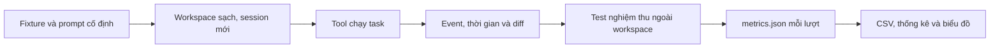

## 3. Thực nghiệm cùng bộ task trên OpenCode, Pi và Codex CLI

Thực nghiệm dùng một repository Python nhỏ, ba yêu cầu cố định và test nghiệm thu tách khỏi workspace của agent. Mỗi công cụ chạy mỗi task ba lần trên bản sao sạch. Tổng số lượt theo thiết kế là **27**, cùng model **`gpt-6.1-sol`** và reasoning **`medium`**. Mỗi lượt được chấm ngay sau khi công cụ dừng, giữ lại log, diff và bản code kết quả để đối chiếu. [Dataset và hash đầu vào](experiments/tool-benchmark/dataset.json) · [Mã điều phối](experiments/tool-benchmark/scripts/run_benchmark.py)

### 3.1. Bộ dữ liệu và yêu cầu của từng task

Repository mẫu là **Cartkit**, gồm tính tổng tiền đơn hàng bằng số nguyên cents, báo cáo đơn hàng theo trạng thái và CLI đọc dữ liệu JSON. Dự án dùng Python standard library, có bốn test gốc và dữ liệu đơn hàng mẫu. Cách chọn này giúp lượt chạy tập trung vào đọc code, chỉnh sửa và kiểm tra hành vi. [Repository đầu vào](experiments/tool-benchmark/fixture/) · [Dữ liệu mẫu](experiments/tool-benchmark/fixture/sample_orders.json) · [Bốn test gốc](experiments/tool-benchmark/fixture/tests/test_existing.py)

| Task | Công việc giao cho agent | Test nghiệm thu | Điểm của code gốc |
| --- | --- | --- | --- |
| T1 — sửa lỗi | Sửa cách xử lý quantity bằng 0, giữ mặc định 1 khi thiếu trường và từ chối kiểu dữ liệu không hợp lệ | 9 | 3/9 |
| T2 — thêm tính năng | Thêm parser CSV, gom dòng theo order ID và nối lệnh `import-csv` vào CLI hiện có | 12 | 0/12 |
| T3 — refactor | Gom logic thống kê vào helper dùng chung và hỗ trợ iterable chỉ duyệt được một lần | 8 | 6/8 |

Tổng cộng có **29 test nghiệm thu** cho ba task. Code gốc vẫn vượt qua cả bốn test sẵn có, trong khi các test bổ sung phát hiện những hành vi cần sửa hoặc chưa được triển khai. T2 đạt 0 vì module và lệnh CSV chưa tồn tại. [Kết quả baseline](experiments/tool-benchmark/dataset.json) · [Log test gốc](experiments/tool-benchmark/results/baseline-tests.log)

**T1 — sửa lỗi tính tiền.** Biểu thức ban đầu là `line.get('quantity') or 1`. Nó thay giá trị 0 bằng 1, đồng thời che mất các giá trị sai như `None` hoặc `False` trước bước kiểm tra kiểu. Task yêu cầu phân biệt trường bị thiếu với trường có giá trị cụ thể. Test kiểm tra giỏ hàng chỉ có quantity 0, giỏ hỗn hợp, mặc định khi thiếu trường, kiểu không hợp lệ, làm tròn discount half-up, phí vận chuyển và việc giữ nguyên input. [Code gốc](experiments/tool-benchmark/fixture/cartkit/money.py) · [Prompt T1](experiments/tool-benchmark/prompts/T1.txt) · [Test T1](experiments/tool-benchmark/acceptance/T1.py)

**T2 — parser CSV và CLI.** Input phải có đúng bốn cột `order_id`, `sku`, `quantity`, `unit_price_cents`; thứ tự header có thể thay đổi. Parser cần trim khoảng trắng, xử lý quoting chuẩn CSV, giữ thứ tự đơn hàng xuất hiện lần đầu và giữ thứ tự các dòng trong từng đơn. Các ca lỗi gồm header thừa/thiếu/trùng, sai số ô, ID rỗng, số âm, số thập phân, chuỗi boolean và chữ số Unicode. Test CLI gọi tiến trình Python rồi parse JSON trả về để kiểm tra tính năng qua entry point người dùng. [Prompt T2](experiments/tool-benchmark/prompts/T2.txt) · [Test T2](experiments/tool-benchmark/acceptance/T2.py)

Ví dụ input hợp lệ của T2 và output mong đợi được thể hiện dưới đây.

```csv
order_id,sku,quantity,unit_price_cents
A,X,1,10
B,Y,2,20
A,X,3,30
```

```json
[
  {"order_id":"A","lines":[
    {"sku":"X","quantity":1,"unit_price_cents":10},
    {"sku":"X","quantity":3,"unit_price_cents":30}
  ]},
  {"order_id":"B","lines":[
    {"sku":"Y","quantity":2,"unit_price_cents":20}
  ]}
]
```

**T3 — refactor có ràng buộc hành vi.** Code gốc duyệt input nhiều lần và lặp lại logic cộng tiền theo khách hàng. Ngoài generator thông thường, test dùng một iterable ném lỗi khi `__iter__` bị gọi lần thứ hai. Các trường hợp khác kiểm tra paid order có tổng 0, đơn pending/cancelled, thứ tự customer key và việc giữ nguyên dữ liệu đầu vào. Cách dùng helper được xem thêm trong bản code kết quả. [Code gốc](experiments/tool-benchmark/fixture/cartkit/reports.py) · [Prompt T3](experiments/tool-benchmark/prompts/T3.txt) · [Test T3](experiments/tool-benchmark/acceptance/T3.py)

### 3.2. Cấu hình và quy trình chạy

| Thành phần | Cấu hình dùng trong lượt đo |
| --- | --- |
| OpenCode | `2.2.7`, chạy một server lab riêng và điều khiển qua Promise SDK |
| Pi | `1.5.0`, CLI JSON mode, chạy bằng Bun `1.4.4` |
| Codex CLI | `0.166.0-alpha.6`, binary có sẵn trên máy, `exec --json --ephemeral` |
| Model | `gpt-6.1-sol` cho cả ba tool |
| Reasoning | `medium` |
| Ngôn ngữ và dependency của task | Python 3.12, standard library |
| Giới hạn thời gian | 240 giây cho mỗi lượt agent |
| Số lần lặp | 3 lượt cho mỗi tổ hợp tool–task |
| Thực thi | Tuần tự, xoay thứ tự tool theo task và lần lặp |
| Workspace | Bản sao sạch dưới `/tmp/coding-benchmark/workspaces/<run_id>` |

Cả ba tool đã vượt qua smoke test bằng model được chọn trước khi bắt đầu task. Ban đầu đã thử dùng model miễn phí của OpenCode qua endpoint trực tiếp; endpoint đó trả HTTP 429. Bộ số liệu chính dùng đăng nhập OpenAI hiện có của từng công cụ. Pi nhập credential từ đăng nhập Codex vào thư mục riêng. OpenCode nhập đúng credential OpenAI đang hoạt động vào DB lab qua API. Credential nằm trong `/tmp`, còn thư mục kết quả chứa dữ liệu đo và mã nguồn tái lập. [Chuẩn bị auth riêng](experiments/tool-benchmark/scripts/prepare_auth.py) · [Server lab](experiments/tool-benchmark/scripts/server.py) · [Smoke Codex](experiments/tool-benchmark/results/smoke-native-codex.jsonl) · [Smoke Pi](experiments/tool-benchmark/results/smoke-native-pi.jsonl) · [Smoke OpenCode](experiments/tool-benchmark/results/smoke-native-opencode.jsonl)

Mỗi lượt nhận cùng prompt task, cùng phần nhắc đọc README và cùng nội dung repo. Pi dùng `--no-extensions --no-skills --no-session`. Codex dùng thư mục cấu hình benchmark riêng, `workspace-write` và chế độ không hỏi phê duyệt. OpenCode cho phép các thao tác của task trong cấu hình lab. Các system prompt và định nghĩa tool gốc vẫn thuộc về từng harness. Đây là những khác biệt của sản phẩm cần quan sát trong thực nghiệm. [Câu lệnh và cấu hình trong runner](experiments/tool-benchmark/scripts/run_benchmark.py) · [Adapter OpenCode](experiments/tool-benchmark/scripts/run-opencode.ts)

Một lượt chạy có trình tự sau.

1. Sao chép fixture và tạo commit baseline với timestamp cố định.
2. Mở session mới, gửi đúng prompt và bắt đầu đồng hồ đo.
3. Thu stdout/event JSONL và stderr đến khi công cụ dừng hoặc timeout.
4. Chạy test nghiệm thu từ bên ngoài workspace, rồi chạy lại toàn bộ thư mục test của repo.
5. Kiểm tra file test gốc vẫn giữ nguyên, lưu diff và snapshot bản sửa.
6. Tính token từ event gốc và ghi `metrics.json` cho lượt đó.

Một lần chạy được đánh dấu hoàn thành khi công cụ kết thúc thành công, toàn bộ test nghiệm thu và test repo đạt, file test gốc giữ nguyên và không bị timeout. Vì vậy, lời agent nói đã sửa xong được kiểm tra tiếp bằng dữ liệu thực thi. [Grader](experiments/tool-benchmark/scripts/grade.py) · [Điều kiện terminal và nghiệm thu](experiments/tool-benchmark/scripts/run_benchmark.py)



*Hình 5. Quy trình của benchmark. Test nghiệm thu là code do harness thực thi sau khi agent kết thúc.* [Runner](experiments/tool-benchmark/scripts/run_benchmark.py) · [Phân tích số liệu](experiments/tool-benchmark/scripts/analyze.py)

### 3.3. Cách đo token và thời gian

**Thời gian** là wall-clock từ lúc tạo tiến trình chạy task đến khi tiến trình đó kết thúc. Nó bao gồm đọc repository, gọi model, thực thi tool, các test do agent tự chạy và ghi đầu ra. Việc chuẩn bị workspace và chạy grader sau đó nằm ngoài đồng hồ. OpenCode dùng server đã khởi động, còn Pi và Codex đi qua CLI mới ở mỗi lượt. Vì thế, số đo phản ánh các entry point được chọn trong lab. [Hàm launch](experiments/tool-benchmark/scripts/run_benchmark.py)

**Token** được chuẩn hóa trước khi so sánh. OpenCode ghi `input` không cache và tách output nhìn thấy khỏi reasoning. Pi cũng tách input không cache, nhưng `output` của nó đã bao gồm reasoning. Codex trả tổng input và cached input theo trường riêng trong `turn.completed`; reasoning là một phần của output. Cộng cached input vào `input_tokens` của Codex hoặc cộng reasoning thêm vào output của Pi sẽ làm số liệu bị tính hai lần. [OpenCode usage](https://github.com/anomalyco/opencode/blob/fedc6f208aa2bd54c1019227214568083f6380ad/packages/core/src/session/usage.ts#L11-L20) · [Pi usage](https://github.com/badlogic/pi-mono/blob/ea1cfcc4c8e82f3ed290abece64d9a76a8b6e2db/packages/ai/src/api/openai-responses-shared.ts#L632-L645) · [Codex JSONL usage](https://github.com/openai/codex/blob/8703d32bd0ea5cf26768859a3dd476df906ba053/codex-rs/exec/src/event_processor_with_jsonl_output.rs#L120-L130)

```text
OpenCode input_total  = input + cache.read + cache.write
OpenCode output_total = output + reasoning

Pi input_total        = input + cacheRead + cacheWrite
Pi output_total       = output

Codex input_total     = input_tokens
Codex output_total    = output_tokens

total_tokens          = input_total + output_total
```

OpenCode được cộng từ từng `session.step.ended`; Pi được cộng từ mỗi `message_end` của assistant. Những event delta và bản sao message trong `agent_end` được bỏ qua khi cộng usage. Codex dùng usage tổng hợp của `turn.completed`. Dữ liệu giữ thêm input không cache, input cache và reasoning để người đọc kiểm tra cách chuẩn hóa. [Mã tính usage](experiments/tool-benchmark/scripts/run_benchmark.py) · [CSV chuẩn hóa](experiments/tool-benchmark/results/trials.csv)

Token trong bảng là tổng token được xử lý qua các lượt model của task, bao gồm phần cache. Nó mô tả kích thước ngữ cảnh được dùng trong toàn bộ lượt chạy. Bảng thành phần token bên dưới tách phần cache để đánh giá rõ hơn lượng input mới. Các số này được lấy từ telemetry; báo cáo không quy đổi chúng thành chi phí tiền tệ.

### 3.4. Kết quả tổng hợp

{{SUMMARY_TABLE}}

{{TASK_TABLE}}


*Hình 6. Cột thể hiện trung vị, chấm thể hiện từng lượt chạy và thanh khoảng thể hiện min–max quan sát được. Mỗi cột có ba mẫu.* [SVG](experiments/tool-benchmark/charts/time-and-tokens.svg) · [Số liệu nguồn](experiments/tool-benchmark/results/trials.csv)

{{TOKEN_TABLE}}


*Hình 7. Tổng token của chín lượt trên mỗi tool, tách input mới, input cache, output nhìn thấy và reasoning.* [SVG](experiments/tool-benchmark/charts/token-composition.svg) · [Thống kê nguồn](experiments/tool-benchmark/results/summary.json)

### 3.5. Dữ liệu từng lượt và đánh giá kết quả

{{TRIAL_TABLE}}

{{ASSESSMENT}}

### 3.6. Phạm vi diễn giải kết quả

Bộ thử gồm ba task nhỏ và ba lần lặp cho mỗi tổ hợp tool–task. Task dùng Python standard library, ít file và không cần dịch vụ ngoài. Kết quả phù hợp để quan sát việc tìm file, sửa code, chạy test và xử lý các trường hợp biên đã nêu. Khả năng làm việc trên codebase lớn, dependency phức tạp, giao diện người dùng và tác vụ kéo dài cần bộ dữ liệu khác để đánh giá.

Cùng model và mức reasoning giúp giảm một nguồn chênh lệch, trong khi system prompt, tool schema, cách chọn context và protocol gọi model vẫn khác theo harness. OpenCode và Pi/Codex dùng các đường tích hợp native của chúng. Cache phía provider và trạng thái mạng cũng thay đổi giữa các lượt. Thứ tự xoay vòng làm các tool có cơ hội xuất hiện ở từng vị trí, còn ba lần lặp mới chỉ cho phép mô tả độ dao động quan sát được. [Lịch chạy](experiments/tool-benchmark/results/schedule.json) · [Manifest](experiments/tool-benchmark/results/manifest.json)

Codex CLI trong lab là một bản alpha có sẵn trong ứng dụng. Pi chạy bằng Bun, và OpenCode dùng server ấm. Những lựa chọn này được giữ cố định trong bộ số liệu và cần được giữ lại khi tái lập. Nhận xét về thời gian áp dụng cho cấu hình thực nghiệm này.

### 3.7. Mã chạy đầy đủ và cách tái lập

| Đường dẫn | Vai trò |
| --- | --- |
| `fixture/` | Repository đầu vào và bốn test gốc |
| `prompts/T1.txt` đến `T3.txt` | Yêu cầu nguyên văn |
| `acceptance/T1.py` đến `T3.py` | Toàn bộ test nghiệm thu |
| `dataset.json` | Danh sách test, baseline và hash fixture |
| `scripts/prepare_auth.py` | Chuẩn bị đăng nhập riêng trong `/tmp` |
| `scripts/server.py` | Khởi động và dừng server OpenCode riêng |
| `scripts/run-opencode.ts` | Gửi task và thu event qua SDK |
| `scripts/run_benchmark.py` | Chạy tool, đo thời gian, chấm test và lưu bản sửa |
| `scripts/grade.py` | Chạy test nghiệm thu và kiểm tra file test gốc |
| `scripts/analyze.py` | Chuẩn hóa usage và xuất thống kê, CSV |
| `scripts/plot_results.py` | Xuất biểu đồ PNG/SVG |
| `results/<run_id>/` | Log, metrics, grade, diff và solution của từng lượt |

Chạy từ `experiments/tool-benchmark`, trên Linux x64 với Python 3, Git, binary Codex phù hợp và đăng nhập OpenAI của các tool. Hai binary OpenCode và Bun có thể dựng lại bằng setup của phần trước.

```bash
python3 ../opencode-v1-v2/scripts/setup.py
/tmp/opencode-lab/runtime/bun-linux-x64/bun install --frozen-lockfile
python3 scripts/prepare_auth.py
python3 scripts/run_benchmark.py --rounds 3
python3 scripts/analyze.py
python3 scripts/plot_results.py
```

Biểu đồ cần dependency trong `requirements-plot.txt`. Có thể cài bằng pip vào môi trường Python dùng để vẽ. Runner nhận `BENCH_CODEX_BIN` nếu binary Codex ở vị trí khác. `BENCH_CODEX_AUTH` và `BENCH_OPENCODE_DB` cho phép chỉ định vị trí đăng nhập cục bộ khi chúng khác mặc định. [Package và lockfile](experiments/tool-benchmark/package.json) · [Dependency biểu đồ](experiments/tool-benchmark/requirements-plot.txt)

Runner bỏ qua lượt đã có `metrics.json`. Khi chạy lại trên máy khác, dùng một bản sao thư mục benchmark có `results/` rỗng và thư mục workspace mới. Toàn bộ code nghiệm thu nằm trong gói báo cáo để có thể chấm lại `solution/` đã lưu mà không cần gọi model thêm.

